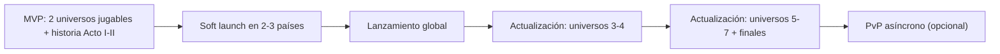

# 00 · Visión y estrategia

## 1. Concepto en una frase

**ÆON: Guerra de los Siete Velos** (título provisional) es un juego móvil de estrategia 4X / *god game* en el que el jugador es una deidad recién nacida: el destino le asigna al azar uno de siete universos, cada uno con sus propias leyes físicas. Desde ahí conquista un planeta, luego su sistema solar, su galaxia y su universo, y al final se enfrenta a los otros siete dioses en sus universos para decidir el destino del multiverso.

## 2. Pilares de diseño

Cada función nueva se evalúa contra estos cinco pilares. Si no refuerza al menos uno, no entra.

| # | Pilar | Qué significa en la práctica | Ejemplo |
|---|---|---|---|
| 1 | **Escala divina** | Pasar del zoom de un planeta al de un multiverso tiene que sentirse como ganar poder. | Cámara de zoom continuo planeta → sistema → galaxia → universo. |
| 2 | **Cada universo cambia las reglas** | Las leyes físicas cambian la estrategia, además del color. | En Thalassa (fluido) las corrientes deciden por dónde se expande el jugador. |
| 3 | **Decisiones con peso moral** | Conquistar con miedo, con fe o con conocimiento lleva a finales distintos. | Los Cataclismos reducen el libre albedrío y alejan el final de Trascendencia. |
| 4 | **Partidas que caben en el bolsillo** | Sesiones de 5–15 min con pausa en cualquier momento. | Turnos simultáneos y guardado automático al final de cada turno. |
| 5 | **Bello y ligero** | Estilo low-poly premium con buena iluminación en lugar de fuerza bruta gráfica. | Planetas procedurales de 1 textura de 256×1 por paleta. |

## 3. Público objetivo

| Segmento | Perfil | Qué buscan | Cómo lo atendemos |
|---|---|---|---|
| Primario | 18–40 años, jugadores de estrategia en móvil (Polytopia, Civilization VI móvil, Stellaris-like, Reigns) | Profundidad sin microgestión; partidas cortas | Turnos simultáneos, 4 recursos, IA con personalidad |
| Secundario | Fans de ciencia ficción y mitología | Historia, lore, mundos raros | 7 universos con identidad propia, trama con finales múltiples |
| Terciario | Jugadores casuales "curiosos" | Algo visualmente llamativo | Onboarding guiado, milagros espectaculares, modo historia en dificultad baja |

Clasificación por edad prevista: **PEGI 12 / ESRB T / IARC 12+**. Hay violencia fantástica sin sangre y temas religiosos ficticios. No se usan religiones reales.

## 4. Propuesta de valor

1. **Siete físicas, siete juegos.** Cada universo tiene leyes distintas (gravedad invertida, tiempo no lineal, cuatro dimensiones, cristal-sonido, energía pura, fluido y sueños) que cambian los recursos, los costes y las tácticas.
2. **Inicio aleatorio y reproducible.** La semilla decide en qué universo naces, así que cada partida empieza distinta. Además, la semilla se puede compartir ("juega mi multiverso").
3. **Tres vías de conquista con consecuencias.** Militar, cultural-religiosa y tecnológica. La mezcla que uses decide el final.
4. **Historia de autor dentro de un sandbox.** Hay actos y capítulos guionizados sobre un mundo procedural.
5. **Ético.** Sin pay-to-win y con un modo completamente offline.

## 5. Estrategia de producto

- **Lanzar pequeño y crecer.** El MVP sale con 2 universos completos. Los demás llegan como actualizaciones de contenido descargadas vía Addressables, lo que mantiene el paquete base por debajo de 150 MB.
- **Monetización ética.** Se recomienda un modelo híbrido:
  - **Opción A, premium** (4,99–7,99 USD): todo el contenido incluido, sin anuncios. Es el más simple y el mejor valorado por el público de estrategia.
  - **Opción B, free-to-play** con el Acto I gratis, desbloqueo de la campaña completa (pago único), cosméticos (aspectos de dioses, paletas de universo, efectos de milagros) y un pase de temporada cosmético.
  - **Prohibido:** vender recursos jugables, cajas de botín pagadas con azar, temporizadores que se aceleran pagando o ventajas en PvP.
  - Recomendación: **B con desbloqueo único**. Baja la barrera de entrada y conserva la confianza del jugador. Cumple las guías 3.1 de Apple y la política de Pagos de Google Play (todas las compras digitales van por StoreKit / Google Play Billing).

## 6. Decisión tecnológica

### 6.1 Requisitos que condicionan la elección

| Requisito | Impacto técnico |
|---|---|
| Publicar en App Store y Play Store | Exportación nativa iOS (Xcode) y Android (AAB) madura |
| Gráficos vistosos pero ligeros | Pipeline de render móvil configurable, shaders personalizados, post-proceso barato |
| Generación procedural (planetas, sistemas, galaxias) | CPU multihilo eficiente; no depender de compute shaders en gama baja |
| 7 universos de contenido distinto | Descarga de contenido bajo demanda |
| Equipo indie pequeño | Ecosistema grande, documentación, assets y talento contratable |
| Backend ligero (guardado en nube, rankings, configuración remota) | SDK integrados con el motor |

### 6.2 Comparativa de motores

Puntuación de 1 (malo) a 5 (excelente) para *este* proyecto.

| Criterio | **Unity 6 LTS (URP, C#)** | Godot 4 (GDScript/C#) | Unreal Engine 5 (C++/Blueprints) | Flutter + Flame (Dart) | Cocos Creator (TS) |
|---|---|---|---|---|---|
| Exportación iOS/Android | 5 | 3 (C# en iOS todavía experimental) | 4 | 5 | 5 |
| Rendimiento 3D en gama baja | 4 | 3 | 2 (APK grande, coste base alto) | 1 (2D) | 3 |
| Shaders y post-proceso móvil | 5 (Shader Graph + HLSL, URP) | 4 | 5 (pero pesado) | 1 | 3 |
| Procedural multihilo | 5 (Jobs + Burst) | 3 | 4 | 2 | 2 |
| Contenido descargable | 5 (Addressables + Play Asset Delivery) | 3 | 4 | 2 | 3 |
| Backend integrado | 5 (Unity Gaming Services) | 2 | 3 | 3 (Firebase) | 2 |
| Ecosistema, assets y talento | 5 | 3 | 4 | 3 | 2 |
| Tamaño del build base | 4 (~35–60 MB vacío) | 5 (~25 MB) | 2 (>100 MB) | 5 | 5 |
| Coste de licencia | 4 (Personal gratis hasta 200 k USD/año; luego Pro) | 5 (MIT) | 4 (5 % de royalties > 1 M USD) | 5 | 5 |
| **Total** | **42** | 31 | 32 | 27 | 30 |

### 6.3 Decisión

- **Motor:** Unity 6 LTS con **URP** (Universal Render Pipeline).
- **Lenguaje de juego:** **C#** (.NET Standard 2.1, compilado con IL2CPP para iOS y Android).
- **Shaders:** **Shader Graph** para artistas (planetas, VFX) y **HLSL** escrito a mano para los shaders críticos (atmósfera, toon de personajes). Ver [`codigo/Shaders`](codigo/Shaders).
- **Generación procedural:** C# con **C# Job System + Burst + Unity.Mathematics**. Se usan compute shaders solo como mejora opcional, porque muchas GPU Mali/Adreno de gama baja los soportan mal o los ejecutan lento.
- **Contenido:** **Addressables**, con un grupo por universo. En Android se entrega con **Play Asset Delivery** (install-time para el universo inicial, on-demand para el resto). En iOS se descarga desde un CDN (Unity Cloud Content Delivery), porque Apple está sustituyendo On-Demand Resources por Background Assets y no conviene depender de ninguno de los dos mientras cambian. Conviene revisar el estado de ambas tecnologías al iniciar la producción.
- **Paquetes:** Input System (táctil y gestos), Cinemachine (cámara de zoom continuo), DOTween (tweens de UI y cámara), UI Toolkit para menús y HUD (uGUI para elementos en espacio de mundo), Unity Localization, Unity IAP.
- **Backend:** **Unity Gaming Services**: Authentication (anónima + Apple/Google), Cloud Save, Remote Config (balance en caliente), Leaderboards y Analytics. **Firebase Crashlytics** para fallos. Alternativa: PlayFab, si se quiere backend propio de economía más adelante.
- **Arte:** Krita / Procreate (concept), Blender (modelado, rig, animación), Substance 3D Painter o ArmorPaint (texturas), Spine / Live2D opcional para retratos. Ver [04_diseno_de_personajes.md](04_diseno_de_personajes.md).
- **Audio:** FMOD Studio (gratis para presupuestos indie menores de 200 k USD) para música adaptativa por capas. Unity Audio basta si el equipo es mínimo.

### 6.4 Por qué no las alternativas

- **Godot 4:** excelente y gratuito, pero en 2025–2026 el soporte de C# para iOS sigue siendo experimental, y no tiene un equivalente maduro de Burst ni de UGS. Es buena opción si el juego fuera 2D.
- **Unreal 5:** visualmente superior, pero Nanite y Lumen no están pensados para móvil. El build base y el consumo de batería son altos, y C++ ralentiza la iteración de un equipo pequeño.
- **Flutter + Flame:** bueno para 2D casual. No tiene un pipeline 3D real.
- **Cocos Creator:** ligero y popular en Asia, con menos ecosistema 3D, menos talento en Occidente y menos documentación en español/inglés.

### 6.5 Riesgos de la decisión y mitigación

| Riesgo | Mitigación |
|---|---|
| Cambios de licencia de Unity | Fijar una versión LTS. La lógica de dominio y simulación es C# puro sin dependencias de motor (ver [06_arquitectura_tecnica.md](06_arquitectura_tecnica.md)), así que se podría portar. |
| Builds IL2CPP lentos | CI en la nube (Unity Build Automation o GameCI) con caché de Library. |
| Peso de URP en gama muy baja | Perfiles de calidad por dispositivo (ver [09_rendimiento_y_optimizacion_movil.md](09_rendimiento_y_optimizacion_movil.md)). |

## 7. Elección del género de turnos

| Opción | Pros | Contras | Veredicto |
|---|---|---|---|
| Turnos secuenciales clásicos (Civ) | Fácil de entender | Esperas largas mientras actúa la IA (7 dioses) | No |
| Tiempo real pausable (Stellaris) | Dinámico | Difícil de controlar en una pantalla táctil pequeña; gasta más batería | No |
| **Turnos simultáneos ligeros** | Todos planifican a la vez y se resuelve en una animación de 3–6 s; las sesiones se pueden cortar en cualquier turno; sirve para PvP asíncrono | Requiere reglas de resolución de conflictos | **Sí** |

Cada turno se llama **"Ciclo"**. Una partida de campaña dura unos 150–300 ciclos repartidos en muchas sesiones. Una escaramuza (un solo universo) dura entre 40 y 80 ciclos.

## 8. Métricas de éxito

| Métrica | Objetivo en soft launch | Objetivo en lanzamiento |
|---|---|---|
| Retención D1 / D7 / D30 | 40 % / 15 % / 6 % | 45 % / 18 % / 8 % |
| Sesiones por día | 2,5 | 3 |
| Duración media de sesión | 9 min | 10–12 min |
| Tasa de crash (sesiones sin fallo) | > 99,5 % | > 99,8 % |
| Valoración en tienda | ≥ 4,3 | ≥ 4,5 |
| Conversión a desbloqueo (F2P) | 3 % | 4–6 % |
