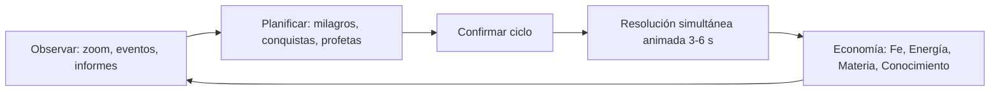
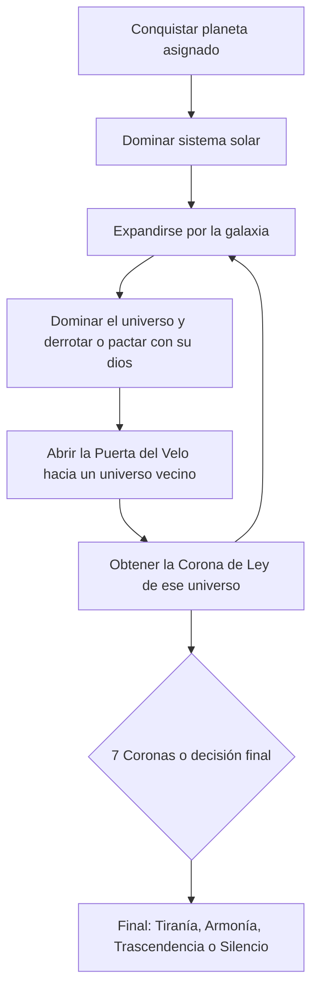
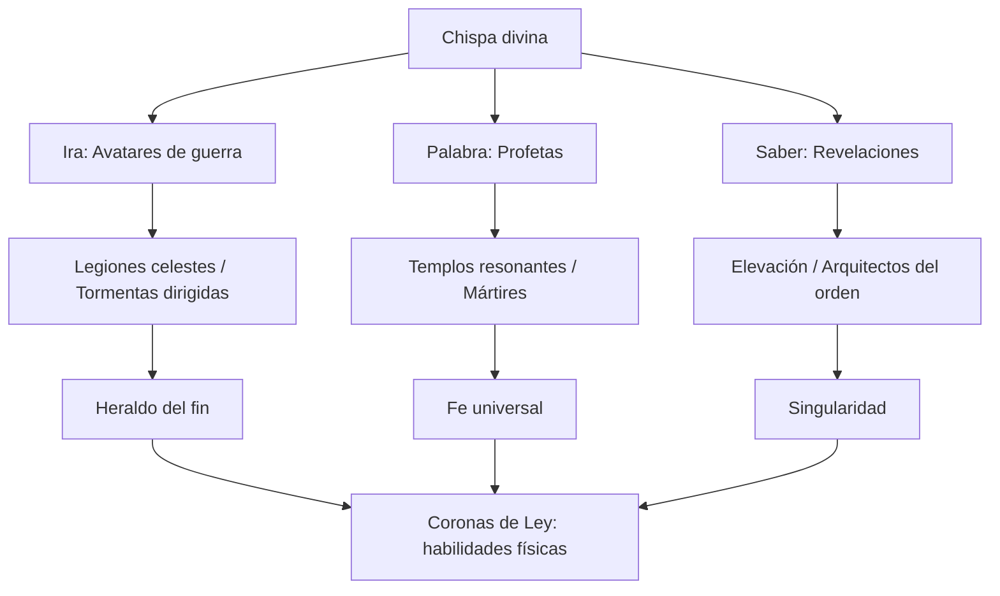
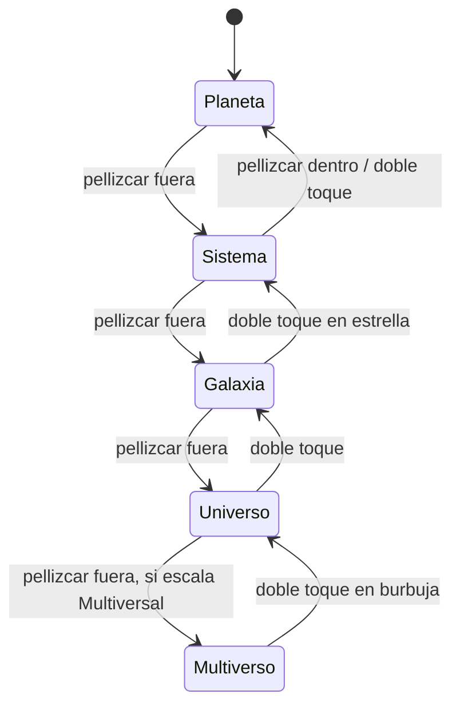

# 01 · Game Design Document (GDD)

> Documento vivo. Los valores numéricos son **valores iniciales de diseño**. Se ajustan con simulaciones automáticas ([10_QA_testing_y_balance.md](10_QA_testing_y_balance.md)) y con Remote Config después del lanzamiento.

## 1. Resumen

| Campo | Valor |
|---|---|
| Género | Estrategia 4X / god game por turnos simultáneos |
| Plataformas | iOS 15+ y Android 8.0+ (API 26), teléfono y tableta |
| Orientación | Horizontal (landscape). El modo vertical se reserva para menús de diálogo. |
| Modos | Campaña (historia, 7 universos), Escaramuza (1 universo, semilla libre) y, más adelante, PvP asíncrono |
| Duración | Campaña de 25–40 h; escaramuza de 45–90 min repartidos en sesiones de 5–15 min |
| Jugadores | 1 jugador contra hasta 7 dioses IA |

## 2. Fantasía del jugador

> "Despierto sin nombre en un universo que no es el mío. Una sola civilización me oye rezar. Si consigo que crea en mí, tendré poder; con poder, estrellas; con estrellas, el derecho a desafiar a los dioses que se repartieron la realidad."

## 3. Bucles de juego

### 3.1 Core loop (un ciclo, 30–90 s)



1. **Observar.** El jugador revisa el informe del ciclo anterior (conversiones, herejías, ataques rivales) y navega con el zoom.
2. **Planificar.** Asigna hasta *N* acciones (N = 2 al inicio, 5 al final; crece con la escala). Cada acción es un comando: Milagro, Conquista o Diplomacia.
3. **Resolver.** Todos los dioses resuelven a la vez. Primero los milagros, luego las conquistas, en orden determinista.
4. **Economía.** Llegan los ingresos según las leyes del universo de cada planeta.

### 3.2 Meta loop (horas)



Al reunir una **Corona de Ley** el jugador obtiene una habilidad permanente basada en la física de ese universo. Por ejemplo, la Corona de Cronalis permite un "Eco" (deshacer el último ciclo) por cada 10 ciclos.

## 4. Escalas de progresión

| Escala | Objetivo | Desbloqueo | Acciones/ciclo | Cámara | Código |
|---|---|---|---|---|---|
| 0 · Planetaria | Convertir la civilización del planeta asignado | Inicio | 2 | Órbita baja, regiones del planeta | `ProgressionStage.Planetaria` |
| 1 · Sistémica | Ganar ≥ 50 % de los planetas del sistema | Poseer el planeta natal | 3 | Sistema solar con órbitas | `Sistemica` |
| 2 · Galáctica | 8 planetas | Dominar el sistema natal | 3 | Galaxia espiral | `Galactica` |
| 3 · Universal | ≥ 60 % de los planetas civilizados del universo | 8 planetas | 4 | Varias galaxias | `Universal` |
| 4 · Multiversal | Coronas de Ley | Dominar el universo natal | 5 | Mapa del multiverso (7 burbujas) | `Multiversal` |

Las reglas de alcance están implementadas en `GameState.CanReach`. Actuar sobre un objetivo cuesta más según la distancia: mismo sistema ×1, misma galaxia ×1,5, otra galaxia ×2,5 y otro universo ×4. Este factor se multiplica además por el factor de viaje de las leyes físicas del universo destino.

**Escala planetaria (Acto I).** Durante el tutorial, el planeta asignado se divide en 6–12 **regiones** (teselación de Voronoi sobre la esfera) que se convierten de una en una. El código de ejemplo resuelve la conquista a nivel de planeta entero. Las regiones son una extensión de `Planet` (`List<Region>`) que solo se usa en el Acto I y en planetas "capital".

## 5. Recursos y economía

| Recurso | Icono / color | Se obtiene de | Se gasta en | Límite |
|---|---|---|---|---|
| **Fe / Devoción** | Llama dorada | √población × fe de cada planeta que te adora | Conquista cultural, profetas, bendiciones | Sin límite; decae un 2 % por ciclo sobre 500 |
| **Energía Divina** | Orbe violeta | 30 % de la Fe generada + 1 por planeta + energía nativa del universo | Todos los milagros | Capacidad = 50 + 10 × planetas |
| **Materia** | Cubo cian | Planetas propios (×estabilidad de la materia del universo) | Conquista militar, terraformación, avatares | Sin límite |
| **Conocimiento** | Prisma verde | Nivel tecnológico de las civilizaciones propias | Conquista tecnológica, Revelación, árbol divino | Sin límite |

Fórmulas base por planeta y ciclo (ver `TurnManager.RunEconomy`):

```text
Fe          = sqrt(población) · fe · 0,5 · mod.faithGain · timeFlowRate
Energía     = 1 · mod.divineEnergyGain + Fe · 0,3 · mod.divineEnergyGain
Materia     = 2 · mod.matterGain · matterStability
Conocimiento= techLevel · 0,5 · mod.knowledgeGain · timeFlowRate
```

**Equilibrio buscado.** A los 10 ciclos un jugador medio debe poder hacer 1 conquista cultural y 2 milagros por ciclo. Si el multiplicador de un universo hace que una vía domine a las demás por más de un 30 % de tasa de victoria en las simulaciones, se rebalancea.

## 6. Milagros

| Milagro | Objetivo | Coste base | Efecto | Universo donde destaca |
|---|---|---|---|---|
| Bendición | Planeta propio | 5 Fe + 8 Energía | +15 % de fe, +10 % de estabilidad | Oniria (×2 por creencia) |
| Profeta | Planeta ajeno | 10 Fe + 6 Energía | −12 % de fe hacia su dios actual | Resonancia (se propaga a planetas "afinados") |
| Revelación | Planeta propio | 10 Energía + 8 Conocimiento | +1 nivel tecnológico, +libre albedrío | Teseracto |
| Cataclismo | Planeta ajeno | 20 Energía + 5 Materia | −8 de defensa, −15 % de población, −libre albedrío | Fulgor |
| *Eco temporal* (Corona) | Ciclo | 40 Energía | Deshace el último ciclo propio | Cronalis |
| *Marea* (Corona) | Sistema | 30 Energía | Redirige corrientes: abarata el viaje ×0,5 durante 3 ciclos | Thalassa |
| *Caída ascendente* (Corona) | Planeta | 35 Energía + 15 Materia | Lanza la luna del planeta contra un enemigo del sistema | Ascendia |

Los milagros se presentan con VFX cortos (≤ 2 s) que se pueden saltar con un toque. El coste final es `base × UniverseRules.modifiers.miracleCost`.

## 7. Árbol divino (tecnología del dios)

El árbol tiene tres ramas, que corresponden a las tres vías de conquista, y un tronco común. Se paga con Conocimiento y cada nodo ofrece una elección entre 2 opciones que se excluyen entre sí. Así el árbol funciona como una toma de decisiones y no como una lista para completar.



**Evolución de especies.** Además del árbol del dios, cada civilización tiene un nivel tecnológico de 0 a 10 (tribal, agrícola, industrial, digital, estelar, trascendente). En los niveles 3, 6 y 9 el dios elige una **mutación** de la especie, por ejemplo *Coro Silíceo → Coro Armónico (más fe) o Coro Disonante (más defensa)*. Estas mutaciones cambian el modelo 3D mediante blendshapes o piezas modulares (ver [04_diseno_de_personajes.md](04_diseno_de_personajes.md)).

## 8. Tipos de conquista

| Vía | Mecánica | Velocidad | Coste | Consecuencias |
|---|---|---|---|---|
| **Militar** | Ataque = (15 + 3 × planetas propios + 5 % de la Materia) × militaryStrength × azar(0,8–1,2) contra Defensa | 1 ciclo | Materia + Energía | −30 % estabilidad, −10 % libre albedrío, −10 % población. Tiende al final Tiranía. |
| **Cultural / religiosa** | Cada ciclo reduce la fe hacia el dios actual un 25 % × culturalSpread × (1 − estabilidad/2). Por debajo de 20 % de fe, el planeta se convierte. | 2–5 ciclos | Fe | Sin daño. Fe inicial del 45 %. Tiende al final Armonía. |
| **Tecnológica** | Eleva +1 el nivel tecnológico; probabilidad de adopción de 40 % × techProgress + 6 % × nivel | 1–3 ciclos | Conocimiento | +10 % libre albedrío. Tiende al final Trascendencia. |

Implementación de referencia: [`codigo/Simulation/Commands/ConquerPlanetCommand.cs`](codigo/Simulation/Commands/ConquerPlanetCommand.cs).

## 9. Combate

El combate se resuelve automáticamente, sin microgestión. El jugador influye antes del ciclo (qué envía y qué milagros prepara) y no durante él.

- **Unidades divinas** (3 arquetipos que forman un triángulo de ventajas):
  - **Avatar** (cuerpo a cuerpo, alta vida) > **Enjambre** (muchas unidades pequeñas)
  - **Enjambre** > **Heraldo** (a distancia, frágil)
  - **Heraldo** > **Avatar**
  - Ventaja = +30 % de ataque.
- **Defensa planetaria** = base + 5 × nivel tecnológico + fortificaciones. Los cataclismos la reducen.
- **Presentación.** Escena orbital de 3–6 s con cámara Cinemachine, impactos y ráfagas en el planeta. Se puede ver acelerada ×2 o saltar.
- **Conflicto simultáneo.** Si dos dioses atacan el mismo planeta en el mismo ciclo, se resuelve por prioridad, después por id de dios (orden estable) y después por orden de envío. En la versión final, los atacantes combaten entre sí primero y el ganador se enfrenta a la defensa.

## 10. Diplomacia

| Acción | Requisito | Efecto |
|---|---|---|
| Tregua (10 ciclos) | Opinión ≥ −20 | Prohíbe atacarse; romperla da −50 de opinión con **todos** los dioses |
| Pacto de fe | Opinión ≥ 30 | Los profetas de ambos no se anulan; +10 % de Fe compartida |
| Tributo | Cualquiera | Entregar recursos a cambio de +opinión |
| Alianza contra Nihil | Acto III | Fuerzas combinadas contra la Marea del Vacío |
| Absorción | El dios rival tiene ≤ 2 planetas | Fusionarse con él: obtienes su Corona; final Tiranía +1 |

**Opinión** (−100 a 100), con modificadores visibles para el jugador: "Te temo (−20, Cataclismos)" o "Compartimos enemigo (+15)". La afinidad de personalidad también pesa: un dios con alta diplomacia perdona antes.

## 11. IA de dioses rivales

- **Técnica:** Utility AI (puntuación de opciones) para la estrategia de cada ciclo. Para secuencias guionizadas de la historia (por ejemplo, la traición de Aeterna en el Acto III) se usan árboles de comportamiento o scripts.
- **Personalidad:** 5 pesos (agresión, piedad, curiosidad, diplomacia, avaricia) que multiplican las consideraciones. Ver la tabla de dioses en [02_trama_y_lore.md](02_trama_y_lore.md).
- **Consideraciones por acción:** valor del planeta (curva logística), probabilidad de éxito (cuadrática), asequibilidad, inversa de la distancia y amenaza.
- **Dificultad:** acciones por ciclo, multiplicador de puntuación y número de candidatas en el sorteo final (1 = óptimo y predecible; 3 = humano).
- **Equidad:** la IA no ve la niebla de guerra del jugador más allá de lo que vería un humano y no recibe recursos extra en dificultad normal.

Implementación: [`codigo/AI/GodUtilityAI.cs`](codigo/AI/GodUtilityAI.cs).

## 12. Condiciones de victoria y derrota

| Tipo | Condición |
|---|---|
| Victoria de escaramuza | Poseer ≥ 75 % de los planetas civilizados del universo, o que todos los rivales estén derrotados o pactados |
| Victoria de campaña | Reunir las 7 Coronas de Ley (o las de los universos generados) y tomar la **Decisión del Telar** (finales en [02_trama_y_lore.md](02_trama_y_lore.md)) |
| Derrota | Perder todos los planetas después de haber poseído el planeta natal, o que la Marea de Nihil consuma tu universo natal (Acto III, temporizador visible) |
| Derrota "suave" | En dificultad Historia, el jugador "renace" en otro planeta de su universo con −50 % de recursos |

## 13. UX/UI móvil

### 13.1 Controles táctiles

| Gesto | Acción |
|---|---|
| Toque | Seleccionar planeta, sistema o unidad |
| Doble toque | Enfocar y bajar un nivel de zoom |
| Arrastrar con 1 dedo | Orbitar la cámara (planeta) o desplazarse (galaxia) |
| Pellizcar | **Zoom continuo** entre escalas |
| Mantener pulsado | Menú radial de acciones (milagros y conquistas) |
| Deslizar desde el borde derecho | Panel de informe del ciclo |
| Botón grande "Ciclo" (abajo a la derecha) | Confirmar y resolver |

Las zonas táctiles miden como mínimo 44 × 44 pt (Apple HIG) o 48 × 48 dp (Material). El HUD respeta las *safe areas* (notch y barra de gestos).

### 13.2 Cámara de zoom continuo



- Cada escala es una **capa** con su propia escala de unidades. Se usan *floating origin* y cambio de escala al cruzar umbrales, para no perder precisión de float con distancias astronómicas.
- Al cruzar de capa: fundido cruzado de 0,3 s, cambio de LOD (el planeta 3D pasa a ser un impostor o sprite) y cambio de la cámara virtual de Cinemachine.
- El zoom es logarítmico: `distancia = exp(lerp(ln(min), ln(max), t))`.

### 13.3 Pantallas principales

1. Título, con la selección de semilla escondida en "Opciones avanzadas".
2. **Ritual de nacimiento**: animación de la tirada del Telar que muestra el universo asignado (sirve de presentación del azar).
3. Vista de juego (HUD con los 4 recursos arriba, botón Ciclo, menú radial).
4. Árbol divino.
5. Diplomacia (retratos 2D animados de los dioses).
6. Códice (lore desbloqueado, especies, leyes físicas).
7. Ajustes (calidad gráfica, 30/60 fps, accesibilidad: tamaño de texto, modos para daltonismo, reducción de destellos).

## 14. Onboarding y tutorial

| Ciclo | Enseña | Cómo |
|---|---|---|
| 0 | Universo aleatorio | Cinemática interactiva: el jugador "lanza" el dado del Telar |
| 1–3 | Bendición y Fe | Narrador (Somnael, voz en off) guía el primer milagro sobre una región |
| 4–6 | Profeta y conversión cultural | Convertir 3 regiones; aparece la barra de fe |
| 7–9 | Conquista militar | Una tribu hostil ataca; se presenta el triángulo de unidades |
| 10 | Planeta conquistado | Se desbloquea el zoom a escala Sistema (momento "wow" de cámara) |
| 11–15 | Revelación y Conocimiento | Primera mutación de especie |
| 16+ | Libertad | Las pistas pasan a ser opcionales (icono "?") |

Reglas del tutorial: nunca más de una mecánica nueva por ciclo, que se pueda saltar entero en la segunda partida, y que el texto nunca supere 2 líneas por globo.

## 15. Accesibilidad

- Paletas probadas con simuladores de daltonismo. Los dueños de planetas se distinguen por **color y patrón** (anillos, glifos).
- Modo "sin destellos" que limita el bloom y los VFX de cataclismo.
- Todos los textos en Unity Localization con tamaño escalable entre 80 % y 140 %.
- Juego completamente jugable con una mano en modo vertical (meta a medio plazo).
