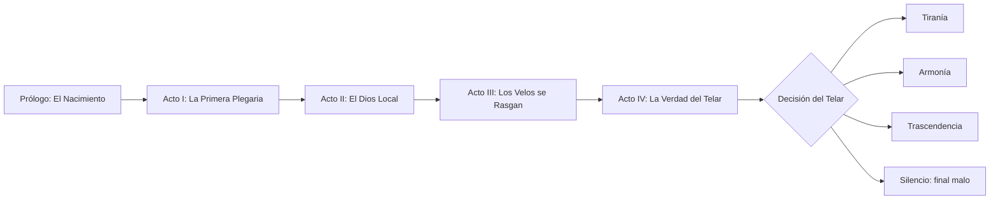

# 02 · Trama y lore

## 1. Tono

Es **mito cósmico con calidez**. La escala es grandiosa (estrellas, universos, dioses), pero las historias que importan son pequeñas: un profeta que duda, una especie cristalina que canta para no olvidar, un dios que tiene miedo de morir. Se busca humor seco en los diálogos entre dioses, como en una familia disfuncional de inmortales, y melancolía en la revelación final.

Referencias de tono: *Hades* (dioses con personalidad), *Outer Wilds* (misterio cósmico y ciclos), *Dune* (fe como poder político) y *La historia interminable* (la Nada que lo devora todo).

## 2. Premisa

Antes del tiempo existía **Aion**, un único multiverso consciente: una mente hecha de leyes. Cada ley (la gravedad, el tiempo, la forma, el sonido, la energía, el flujo y el sueño) era un pensamiento de Aion.

Hace una eternidad ocurrió **el Quiebre**. Aion se partió en **siete universos**, uno por cada ley dominante, separados por membranas llamadas **Velos**. De cada fragmento nació un dios que encarna esa ley: los **Siete**.

Desde los bordes del multiverso avanza **Nihil, el Vacío que Recuerda**, una marea de no-existencia que borra estrellas y que ninguno de los Siete puede detener solo.

En la grieta del Quiebre se formó algo que no debía existir: **el Octavo**. Es una chispa divina sin universo propio, y es el jugador. El **Telar** (el mecanismo que aún une los fragmentos) tira sus hilos y lo deposita **al azar** en uno de los siete universos, frente a un único planeta que todavía no reza a nadie.

> **Por qué compiten los dioses.** Una antigua profecía dice que quien reúna las siete **Coronas de Ley** podrá reforjar a Aion y detener a Nihil. Cada dios cree que solo él merece hacerlo, porque reforjar a Aion a su imagen significaría que *su* ley sería la única verdadera.

> **Por qué el universo es aleatorio (justificación narrativa).** El Telar no elige: *recuerda*. Cada partida es un "hilo" distinto de un ciclo que se ha repetido muchas veces. La semilla es, literalmente, el número del hilo.

## 3. Estructura

| Acto | Escala | Capítulos | Objetivo jugable | Revelación narrativa |
|---|---|---|---|---|
| Prólogo | — | 0 | Tirada del Telar, elegir nombre y símbolo divino | Eres el Octavo y no tienes universo |
| I · La Primera Plegaria | Planetaria → Sistémica | 1–3 | Convertir tu planeta asignado y su sistema | Una voz (Somnael) te guía; nadie más puede oírla |
| II · El Dios Local | Galáctica → Universal | 4–7 | Expandirte por el universo; enfrentarte o pactar con su dios nativo | El dios local no te odia: **te teme**, porque los Octavos ya existieron antes |
| III · Los Velos se Rasgan | Multiversal | 8–13 | Cruzar a otros universos, ganar Coronas, frenar la Marea de Nihil | Nihil no viene de fuera: es lo que **queda** cuando un ciclo termina |
| IV · La Verdad del Telar | Multiversal | 14–16 | Reunir las Coronas restantes y alcanzar el Núcleo del Telar | **Tú fuiste Aion.** El Octavo es la parte de Aion que *eligió* romperse |

### 3.1 Giros argumentales

1. **Somnael, la voz amable, es un dios rival** (Acto II, capítulo 6). Lleva siglos guiando a cada Octavo, porque es el único que recuerda los ciclos anteriores y quiere que, por una vez, alguien termine distinto.
2. **El dios local no es el villano** (Acto II). Si el jugador derrota a su dios nativo sin diplomacia, descubre en el Códice que ese dios estaba conteniendo a Nihil en su frontera. Derrotarlo adelanta 10 ciclos la Marea.
3. **Nihil recuerda** (Acto III). Los planetas devorados por Nihil reaparecen como "ecos" con las civilizaciones de ciclos anteriores. Nihil es la memoria del multiverso, y su hambre es en realidad cansancio.
4. **Tú fuiste Aion** (Acto IV). El Quiebre no fue un ataque. Aion se rompió a propósito porque una mente única no podía sentir asombro. El Octavo es esa decisión, encarnada.
5. **Aeterna traiciona y luego se redime** (Acto III, capítulo 11). La diosa del tiempo intenta reiniciar el ciclo sola. Si el jugador tiene una opinión alta con ella, en el Acto IV vuelve como aliada.

## 4. Los Siete (dioses rivales)

La personalidad numérica corresponde a `MultiverseGenerator.DefaultRivals` (orden: agresión, piedad, curiosidad, diplomacia, avaricia).

| Dios | Universo | Ley | Aspecto | Personalidad (A/P/C/D/Av) | Motivación | Estilo de juego IA | Arco |
|---|---|---|---|---|---|---|---|
| **Vel'Ascar**, Señor de la Caída Ascendente | Ascendia | Gravedad invertida | Titán de basalto encadenado al cielo, con cadenas que "caen" hacia arriba | 0.8/0.3/0.4/0.2/0.5 | Quiere que nada vuelva a caer, ni él ni nadie | Militar, agresivo temprano, usa lunas como proyectiles | Del orgullo al miedo a caer. Si se le perdona, se convierte en guardián del Velo. |
| **Aeterna**, Tejedora de Horas | Cronalis | Tiempo no lineal | Mujer múltiple: varias edades superpuestas, con un huso de luz | 0.3/0.5/0.8/0.6/0.6 | Detener el tiempo justo antes del fin del ciclo para que nunca termine | Tecnológica, acumula y "rebobina" pérdidas | Traiciona en el Acto III; acepta el cambio si el jugador la convence |
| **Ixxion**, el Geómetra | Teseracto | 4 dimensiones | Politopo vivo: un teseracto que rota y solo deja ver sombras 3D | 0.4/0.2/1.0/0.3/0.4 | Resolver la "ecuación de Aion" y demostrar que todo es forma | Puramente tecnológico, ataques desde ángulos imposibles (atajos 4D) | Descubre que la ecuación no tiene solución única y aprende a dudar |
| **Lyrael**, la Voz Fractal | Resonancia | Cristal y sonido | Coloso de cuarzo con rostro hueco del que sale un coro | 0.2/0.9/0.5/0.8/0.3 | Que todo el multiverso cante una sola canción en armonía | Cultural y diplomática, aliada natural, pero absorbe a sus aliados | Aprende que la armonía necesita voces distintas; clave para el final Armonía |
| **Pyrrhos**, el Incandescente | Fulgor | Energía pura | Tormenta solar con forma de ave, sin cuerpo sólido | 1.0/0.4/0.3/0.1/0.2 | Arder antes de que Nihil lo apague | Kamikaze militar, cataclismos constantes | Se sacrifica contra Nihil en el Acto III si su opinión hacia el jugador es positiva |
| **Nerith**, Madre de las Corrientes | Thalassa | Fluido | Leviatana de agua estelar con colonias coralinas en el lomo | 0.4/0.6/0.4/0.9/0.5 | Proteger a sus "hijos" (las especies) más que a sí misma | Diplomática, comercio de corrientes, defensiva | Mediadora entre dioses; ofrece el Pacto de los Siete en el Acto IV |
| **Somnael**, el Que Sueña | Oniria | Sueños | Figura sin rostro fijo, cubierta de máscaras que cambian según quien la mira | 0.5/0.8/0.6/0.5/0.2 | Romper el ciclo; lleva incontables intentos fallidos | Cultural, impredecible, cambia de bando | Mentor, falso aliado y aliado verdadero. Su destino depende del final. |

**El Octavo (jugador).** No tiene forma fija. Su aspecto se construye con piezas modulares (rostro de luz, aura, símbolo) que **evolucionan según la vía de conquista dominante**: más armadura y fuego con la militar, más halo y túnica con la cultural, más geometría y circuitos con la tecnológica (ver [04_diseno_de_personajes.md](04_diseno_de_personajes.md)).

**Nihil, el Vacío que Recuerda.** Es el antagonista primordial. No tiene cuerpo: se ve como una ausencia, un recorte negro con bordes de estática donde aparecen siluetas de mundos olvidados. Habla con las voces de civilizaciones extinguidas. No se le puede derrotar con fuerza, solo **contener** (con alianzas) o **comprender** (final Trascendencia).

## 5. Finales múltiples

El final depende de 3 medidores ocultos que se calculan a lo largo de la campaña y se guardan como `storyFlags` en el guardado:

| Medidor | Sube con | Baja con |
|---|---|---|
| **Dominio** | Conquista militar, absorciones, cataclismos | Pactos, liberar planetas |
| **Concordia** | Pactos, conquista cultural, salvar a dioses rivales | Romper treguas, absorciones |
| **Libre albedrío** (media de `freeWill` de tus civilizaciones) | Conquista tecnológica, Revelaciones | Cataclismos, conquista militar |

| Final | Requisito | Desenlace |
|---|---|---|
| **Tiranía** | Dominio es el medidor más alto | El Octavo absorbe a los Siete y se convierte en el nuevo Aion. El multiverso queda unificado, ordenado y silencioso. Epílogo: miles de ciclos después, el nuevo Aion siente la primera grieta. El ciclo continúa. |
| **Armonía** | Concordia es la más alta y ≥ 4 dioses siguen vivos | Los dioses firman el Pacto de los Siete (+1). Los Velos siguen existiendo pero se abren puertas. Nihil queda contenida por un canto compartido. Es el final "feliz", aunque precario. |
| **Trascendencia** | Libre albedrío ≥ 0,75 y haber descubierto los 5 ecos de Nihil | El Octavo entrega las Coronas a los mortales: las leyes dejan de tener dueño. Los dioses se vuelven mortales, Nihil se disuelve porque ya nadie necesita olvidar y el ciclo se rompe. Es el final verdadero. |
| **Silencio** (malo) | La Marea consume el universo natal, o el jugador se alía con Nihil (opción oculta en el Acto IV) | Todo se apaga. Pantalla negra con un único latido. En el siguiente intento se desbloquea un diálogo extra de Somnael: "Esta vez lo recuerdas, ¿verdad?". |

## 6. Misiones

### 6.1 Principales (resumen por capítulo)

| Cap. | Título | Objetivo | Mecánica nueva |
|---|---|---|---|
| 1 | La Primera Plegaria | Convertir 3 regiones del planeta asignado | Bendición, Fe |
| 2 | El Falso Profeta | Un culto rival surge en tu planeta; elegir entre absorberlo o destruirlo | Herejía, estabilidad |
| 3 | Bajo Otras Lunas | Conquistar el sistema natal | Zoom a Sistema, conquista de planetas sin civilización |
| 4 | El Ojo del Dios Local | El dios nativo te detecta; primera diplomacia | Opinión, tregua |
| 5 | Rutas de Luz | Expandirte a 3 sistemas | Escala galáctica, coste por distancia |
| 6 | Las Máscaras de Somnael | Revelación del mentor | Diálogo con elecciones |
| 7 | La Corona Natal | Dominar el universo (derrotar, pactar o absorber al dios nativo) | Corona de Ley |
| 8–13 | Los Seis Velos | Un capítulo por universo restante, en orden elegido por el jugador; cada uno tiene un "puzle de leyes" | Física de cada universo |
| 14 | El Núcleo | Llegar al Núcleo del Telar con la Marea creciendo | Temporizador global |
| 15 | Aion | Diálogo con tu yo anterior | Decisión |
| 16 | Epílogo | Final según medidores | — |

Si el universo natal del jugador es, por ejemplo, Thalassa, los capítulos 8–13 cubren los otros seis. El contenido de cada capítulo de universo es modular y se escribe una vez por universo, así que cualquier orden funciona.

### 6.2 Secundarias (ejemplos)

| Misión | Universo | Resumen | Recompensa |
|---|---|---|---|
| El Coro Perdido | Resonancia | Reunir 4 planetas que "desafinan" para restaurar una canción antigua | Mutación *Coro Armónico* |
| Raíces en el Cielo | Ascendia | Ayudar a los Arraigados a anclar una ciudad que flota hacia el vacío | +Defensa permanente en el sistema |
| La Hora Repetida | Cronalis | Un planeta vive el mismo día en bucle: romperlo o explotarlo | Eco temporal extra |
| El Leviatán Huérfano | Thalassa | Escoltar a una cría estelar por corrientes peligrosas | Opinión +30 con Nerith |
| Sueño Compartido | Oniria | Dos civilizaciones sueñan la misma guerra; despertarlas antes de que sea real | Libre albedrío +0,1 |
| Ecos de Nihil (×5) | Cualquiera | Explorar planetas devorados y recuperar memorias | Requisito del final Trascendencia |
| Los Últimos Fieles | Universo natal | Proteger a la civilización original durante la Marea | Logro y escena especial en el epílogo |

### 6.3 Eventos procedurales

Son cartas de evento con 2–3 opciones que aparecen cada 3–5 ciclos. Se generan a partir de plantillas con variables (`{especie}`, `{planeta}`, `{dios}`), por ejemplo: *"Los {especie} de {planeta} piden una señal. ¿Bendices su cosecha (−Energía, +Fe) o les exiges un templo (+Materia, −estabilidad)?"*. Se necesitan unas 60 plantillas por idioma para el lanzamiento.

## 7. Guía de escritura

- Cada dios tiene una **muletilla** y un **registro**. Vel'Ascar habla en imperativo. Aeterna mezcla tiempos verbales. Ixxion usa términos geométricos. Lyrael habla en verso libre. Pyrrhos, en exclamaciones breves. Nerith usa diminutivos maternales. Somnael hace preguntas.
- Ningún diálogo pasa de 3 líneas en móvil. Las ideas largas se reparten en varias pantallas.
- Los textos se escriben en español como idioma fuente y se localizan al inglés al mismo tiempo. Se evitan juegos de palabras intraducibles en las misiones principales.
- No se representan religiones reales. Los símbolos son originales, y los revisa una persona de culturalización antes de cada mercado.
