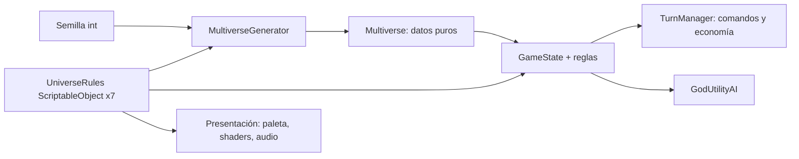
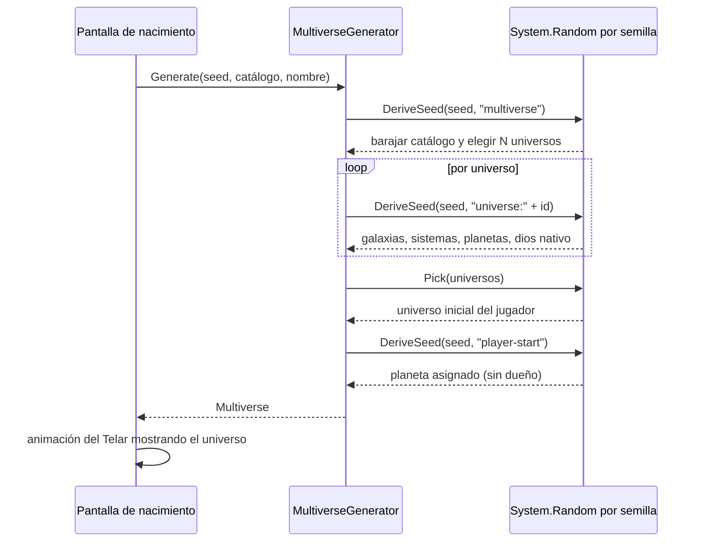

# 03 · Los 7 universos y sus leyes físicas

Cada universo es un **paquete de contenido** (un grupo de Addressables) más un **perfil de leyes** (`UniverseRules`, un ScriptableObject). Las leyes alteran tres capas:

1. **Generación procedural**: número de galaxias, tipos de estrella, órbitas y planetas.
2. **Simulación (gameplay)**: multiplicadores de recursos, costes, eficacia de cada vía de conquista y reglas especiales.
3. **Presentación**: paleta, shaders, partículas, música y comportamiento visual de las órbitas.

## 1. Vista general

| # | Id (`rules.id`) | Nombre | Ley dominante | Paleta | Dios | Energía (`EnergyType`) |
|---|---|---|---|---|---|---|
| 1 | `ascendia` | **Ascendia** | Gravedad invertida | Basalto oscuro, ámbar, cielo turquesa | Vel'Ascar | Gravitica |
| 2 | `cronalis` | **Cronalis** | Tiempo no lineal | Sepia, oro viejo, cian eléctrico | Aeterna | Cronica |
| 3 | `teseracto` | **Teseracto** | 4 dimensiones espaciales | Blanco, negro, magenta y verde ácido | Ixxion | Dimensional |
| 4 | `resonancia` | **Resonancia** | Cristal y sonido | Lila, rosa cuarzo, plata | Lyrael | Armonica |
| 5 | `fulgor` | **Fulgor** | Energía pura | Naranja plasma, blanco, azul profundo | Pyrrhos | Plasmatica |
| 6 | `thalassa` | **Thalassa** | Espacio fluido | Azul abisal, verde bioluminiscente | Nerith | Fluida |
| 7 | `oniria` | **Oniria** | Sueños | Pastel iridiscente, violeta noche | Somnael | Onirica |

## 2. Valores de `UniverseRules` por universo

| Parámetro | Ascendia | Cronalis | Teseracto | Resonancia | Fulgor | Thalassa | Oniria |
|---|---|---|---|---|---|---|---|
| `gravityMultiplier` | **−1.2** | 1.0 | 0.8 | 1.0 | 0.4 | 0.6 | 0.7 |
| `timeFlowRate` | 1.0 | **2.0** | 1.0 | 1.0 | 1.5 | 0.7 | 1.0 |
| `timeModel` | Lineal | **Ramificado** | Lineal | Ciclico | Lineal | Lineal | Ramificado |
| `spatialDimensions` | 3 | 3 | **4** | 3 | 3 | 3 | 3 |
| `lightSpeedFactor` | 1.0 | 1.0 | 1.0 | **0.2** | 3.0 | 0.5 | 1.0 |
| `matterStability` | 1.0 | 0.9 | 0.8 | 1.0 | **0.15** | 0.7 | 0.5 |
| `mediumViscosity` | 0 | 0 | 0 | 0.2 | 0 | **0.8** | 0.1 |
| `beliefToReality` | 0 | 0 | 0 | 0.2 | 0 | 0.1 | **1.0** |
| `modifiers.faithGain` | 0.9 | 1.0 | 0.7 | 1.2 | 0.8 | 1.0 | **2.0** |
| `modifiers.divineEnergyGain` | 1.0 | 1.2 | 1.0 | 1.0 | **2.5** | 1.0 | 1.2 |
| `modifiers.matterGain` | 1.3 | 1.0 | 1.0 | 1.1 | 0.3 | 1.0 | 0.6 |
| `modifiers.knowledgeGain` | 0.9 | 1.4 | **1.8** | 1.0 | 0.8 | 1.0 | 0.9 |
| `modifiers.miracleCost` | 1.0 | 1.2 | 1.0 | 0.9 | **0.6** | 1.0 | 0.8 |
| `modifiers.militaryStrength` | **1.4** | 1.0 | 1.0 | 0.8 | 1.5 | 0.8 | 0.7 |
| `modifiers.culturalSpread` | 0.8 | 1.0 | 0.7 | **1.6** | 0.6 | 1.2 | 1.4 |
| `modifiers.techProgress` | 0.9 | 1.3 | **1.6** | 1.0 | 0.8 | 1.0 | 0.9 |
| `modifiers.travelCost` | 1.0 | 1.0 | 1.0 | 1.0 | 0.8 | 1.0 | 1.2 |
| `modifiers.civilizationStability` | 0.8 | 0.7 | 0.8 | 0.9 | 0.5 | 0.8 | **0.4** |
| `galaxyCount` | 2 | 2 | 1 | 2 | 3 | 2 | 2 |
| `spiralArms` | 2 | 4 | 3 | 5 | 2 | 3 | 6 |

## 3. Detalle por universo

### 3.1 Ascendia: el universo de la gravedad invertida

- **Concepto.** Las masas se repelen. Los planetas no son esferas compactas: son **archipiélagos-anillo** de rocas flotantes que se separan lentamente, unidos por raíces y cadenas. Las estrellas "empujan" a sus planetas hacia fuera, y las órbitas existen porque cadenas de energía gravitica los sujetan.
- **Visual.** Cielo turquesa con nubes que caen hacia arriba, roca basáltica con vetas de ámbar, cadenas brillantes. Al invertir `gravityMultiplier`, la vista refleja el eje Y de las órbitas y los planetas tienen "colas" de escombros que se alejan de la estrella.
- **Especies nativas.**
  - *Arraigados* (no humanoides): seres árbol-pulpo que se anclan con raíces para no salir despedidos. Su tecnología consiste en tejer anclas.
  - *Aeróvoros*: medusas de gas que flotan entre fragmentos.
  - *Gente del Ancla* (humanoides): mineros que viven boca abajo bajo las islas.
- **Efecto en las mecánicas.**
  - Militar ×1,4: lanzar rocas "hacia arriba" contra otros planetas es fácil.
  - Materia ×1,3: los fragmentos se recogen sin esfuerzo.
  - **Regla especial "Deriva":** cada 10 ciclos, los planetas sin dueño pierden 1 de defensa porque se fragmentan.
  - Corona: *Caída ascendente* (lanzar una luna).

### 3.2 Cronalis: el universo del tiempo no lineal

- **Concepto.** El tiempo corre al doble, y las causas y los efectos pueden desordenarse. Las civilizaciones evolucionan rápido pero "recuerdan el futuro".
- **Visual.** Estrellas con estelas de posiciones pasadas (trails), planetas que muestran a la vez varias fases de su superficie (shader de mezcla entre 3 estados por ruido temporal) y relojes de luz en el espacio.
- **Especies.**
  - *Los Eco* (no humanoides): seres que existen en varios instantes a la vez y se ven como siluetas encadenadas con retardo (*ghost trails*).
  - *Quelonios del Ciclo*: tortugas gigantes que llevan ciudades y viven 10 000 años.
- **Mecánicas.**
  - `timeFlowRate = 2`: las órbitas, el crecimiento y el Conocimiento avanzan el doble por ciclo.
  - `TimeModel.Ramificado`: el jugador puede **previsualizar** el resultado de un ciclo una vez cada 5 ciclos (se ejecuta la simulación en una copia del `GameState`, algo posible gracias al determinismo).
  - Milagros ×1,2 más caros (alterar el tiempo es costoso).
  - Corona: *Eco temporal* (deshacer un ciclo).

### 3.3 Teseracto: el universo de 4 dimensiones espaciales

- **Concepto.** Existe una cuarta dirección espacial (W). Los objetos son proyecciones 3D de cuerpos 4D, y su forma cambia al "rotar" en W.
- **Visual.** Planetas que se pliegan sobre sí mismos (un vertex shader que aplica una rotación 4D antes de proyectar a 3D), estrellas como poliedros brillantes y líneas de rejilla. La paleta es de alto contraste.
- **Especies.**
  - *Politopos* (no humanoides): seres hechos de hipercubos y 24-celdas. Su cuerpo cambia de sección visible al moverse.
  - *Los Plegados*: humanoides de papel geométrico que pueden aplanarse en 2D.
- **Mecánicas.**
  - `spatialDimensions = 4` → el factor de viaje es 3/4 = 0,75, así que los atajos son baratos.
  - **Adyacencia extra:** cada sistema tiene 1–2 "pliegues" que conectan con sistemas lejanos como si fueran vecinos.
  - **Niebla dimensional:** los planetas enemigos solo muestran su "sombra"; para ver su defensa real hace falta una Revelación.
  - Conocimiento ×1,8, tecnológica ×1,6.

### 3.4 Resonancia: el universo de cristal y sonido

- **Concepto.** La luz es lenta (`lightSpeedFactor = 0,2`) y el sonido viaja por el vacío. Toda la materia es cristalina y vibra. Las civilizaciones se comunican cantando.
- **Visual.** Planetas facetados con refracción falsa (*matcap* + fresnel), ondas de sonido visibles como anillos que se expanden y nebulosas que pulsan al ritmo de la música.
- **Especies.**
  - *Cantores de Cuarzo* (no humanoides): colonias de cristales que forman un ser al resonar juntos.
  - *Coro Silíceo*: gigantes huecos que son instrumentos vivos.
- **Mecánicas.**
  - Cultural ×1,6.
  - **Regla especial "Afinación":** dos planetas propios con la misma frecuencia (atributo de 1 a 5) dentro de un mismo sistema reciben +20 % de Fe.
  - **Luz lenta:** los informes de los sistemas lejanos llegan con 1–2 ciclos de retraso. Se ve el pasado.
  - `TimeModel.Ciclico`: cada 12 ciclos ocurre un "Gran Acorde" (un evento global repetible).
  - **Interacción con el audio:** la música adaptativa cambia de tonalidad según la fe del jugador.

### 3.5 Fulgor: el universo de energía pura

- **Concepto.** La materia casi no existe (`matterStability = 0,15`). Las estrellas son el único "suelo", y los planetas son burbujas de plasma confinado (`PlanetType.Exotico`).
- **Visual.** Bloom intenso pero controlado, superficies emisivas animadas por ruido y fondos azul profundo para contrastar. Es el universo con más riesgo de sobrecargar la GPU con overdraw, así que se usan menos partículas y más shaders.
- **Especies.**
  - *Llameantes* (no humanoides): seres de plasma con forma de ave o serpiente.
  - *Coronas Vivas*: anillos de fuego conscientes alrededor de las estrellas.
- **Mecánicas.**
  - Energía Divina ×2,5, milagros ×0,6 (baratos), Materia ×0,3 (muy escasa).
  - Militar ×1,5, estabilidad 0,5: las civilizaciones son volátiles y hay muchas herejías.
  - **Regla especial "Combustión":** los planetas sin Bendición durante 8 ciclos pierden un 10 % de población.

### 3.6 Thalassa: el universo del espacio fluido

- **Concepto.** El espacio está lleno de un éter líquido (`mediumViscosity = 0,8`). Las estrellas son faros submarinos, los planetas flotan y las **corrientes** conectan los sistemas.
- **Visual.** *God rays* falsos, cáusticas proyectadas (textura animada barata), partículas en suspensión, bioluminiscencia verde y azul, y órbitas onduladas.
- **Especies.**
  - *Leviatanes estelares* (no humanoides): ballenas del tamaño de lunas que llevan civilizaciones en su lomo.
  - *Colonias coralinas*: una especie que es un arrecife-planeta.
  - *Mareantes*: humanoides anfibios.
- **Mecánicas.**
  - Viaje ×(1 + 0,8) por la viscosidad y ×1,41 por la luz lenta, unos ×2,5 en total. **A favor de la corriente**, el coste se divide entre 2. Las corrientes cambian de dirección cada 6 ciclos.
  - `timeFlowRate = 0,7`: todo es más lento y deliberado.
  - Cultural ×1,2: las ideas viajan con las mareas.

### 3.7 Oniria: el universo de los sueños

- **Concepto.** La realidad se ajusta a lo que creen sus habitantes (`beliefToReality = 1`). Un planeta en el que nadie cree empieza a desvanecerse. La fe es literalmente física.
- **Visual.** Planetas que cambian de forma lentamente (interpolación de blendshapes y ruido), cielos pastel e iridiscentes, islas imposibles y escaleras de Escher. Es el universo de Somnael.
- **Especies.**
  - *Soñantes* (no humanoides): nubes de forma cambiante que adoptan el aspecto de lo que temen o desean.
  - *Quimeras*: criaturas compuestas por partes de otras especies (piezas modulares combinadas).
- **Mecánicas.**
  - Fe ×2 y milagros de fe ×(1 + beliefToReality) = ×2 (ver `MiracleCommand`).
  - Estabilidad 0,4: muchas herejías, y las conversiones se deshacen solas si la fe cae.
  - **Regla especial "Desvanecimiento":** un planeta con fe < 10 % durante 5 ciclos pierde su civilización, que se convierte en un eco.

## 4. Diseño en código

### 4.1 Flujo de datos



- **ScriptableObject `UniverseRules`** ([`codigo/Domain/UniverseRules.cs`](codigo/Domain/UniverseRules.cs)): datos editables por diseño, sin lógica de turnos.
- El modelo serializado (`Universe.rulesId`) solo guarda el **id** de las reglas. Así el balance se puede cambiar en una actualización sin romper los guardados.
- **Remote Config** puede sobrescribir los multiplicadores en caliente: se aplica un parche JSON sobre una **copia** en memoria del ScriptableObject, nunca sobre el asset.

### 4.2 Cómo se aplica cada ley

| Ley | Dónde actúa en el código |
|---|---|
| `gravityMultiplier` | `StarSystemGenerator.ComputePeriodTurns` (T ∝ 1/√G); la vista refleja Y si `IsGravityInverted` |
| `timeFlowRate` | Periodos orbitales; ingresos de Fe y Conocimiento y crecimiento en `TurnManager.RunEconomy` |
| `timeModel` | Sistema de "previsualización de ciclo" (clonar el `GameState` y resolver) y eventos cíclicos |
| `spatialDimensions` | `UniverseRules.ComputeTravelCostFactor`; generación de "pliegues" (adyacencias extra); vertex shader 4D |
| `lightSpeedFactor` | Coste de viaje; retraso de informes de niebla de guerra en la UI |
| `matterStability` | Ingreso de Materia; probabilidad de `PlanetType.Exotico` en la generación |
| `mediumViscosity` | Coste de viaje; sistema de corrientes |
| `beliefToReality` | Potencia de Bendición y Profeta en `MiracleCommand` |
| `modifiers.*` | Costes (`CommandCosts`), conquistas (`ConquerPlanetCommand`) y economía |

### 4.3 Ejemplo de uso del perfil

```csharp
// Asset: Assets/_Game/Data/Universes/UR_Thalassa.asset (creado con Create > GodGame > Universe Rules)
UniverseRules rules = state.GetRulesForPlanet(planet);
float travel = rules.ComputeTravelCostFactor();      // 1.0 * (3/3) * (1+0.8) * (1/sqrt(0.5)) ≈ 2.55
ResourceCost cost = CommandCosts.Conquest(ConquestType.Cultural, planet, rules, distanceFactor: 1.5f * travel);
```

### 4.4 Reglas especiales

Las reglas especiales ("Deriva", "Afinación", "Combustión", "Desvanecimiento"...) se implementan como **estrategias** registradas por id de universo. Así la economía base no se llena de `if (universo == ...)`:

```csharp
namespace GodGame.Simulation
{
    public interface IUniverseRule
    {
        string UniverseRulesId { get; }
        void OnEconomyPhase(GameState state, Universe universe, TurnReport report);
    }

    public sealed class CombustionRule : IUniverseRule   // Fulgor
    {
        public string UniverseRulesId => "fulgor";
        public void OnEconomyPhase(GameState state, Universe universe, TurnReport report)
        {
            foreach (var p in state.Planets)
            {
                if (p.universeId != universe.id || !p.civilization.Exists) continue;
                // ciclosSinBendicion se guardaría en un diccionario por planeta (campo extra del modelo)
                // if (ciclosSinBendicion[p.id] >= 8) p.civilization.population *= 0.9f;
            }
        }
    }
}
```

`TurnManager` recibiría una `List<IUniverseRule>` y llamaría a `OnEconomyPhase` tras `RunEconomy`. El código de ejemplo no incluye esta extensión para mantenerlo compacto.

## 5. Asignación aleatoria del universo inicial



- **La semilla** se genera con `Environment.TickCount` o la introduce el jugador ("Opciones avanzadas"). Se muestra en "Detalles de partida" para poder compartirla.
- **Sub-semillas por universo** (`DeriveSeed(seed, "universe:ascendia")`): añadir un universo nuevo en una actualización **no** cambia los ya existentes de una semilla compartida.
- **Hash estable** (FNV-1a en `RandomExtensions.DeriveSeed`). `string.GetHashCode()` no sirve, porque en .NET puede variar entre ejecuciones y plataformas.
- **MVP con 2 universos:** el catálogo que se pasa al generador contiene solo los universos instalados o desbloqueados, y el azar elige entre ellos. Cuando se descargan más, las partidas nuevas los incluyen.
- **Garantía de jugabilidad:** el generador asegura que siempre exista un planeta habitable con civilización para el jugador y que no sea el del dios local.
