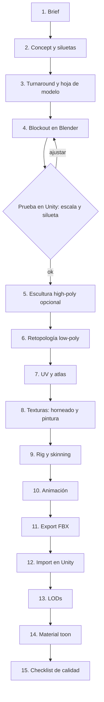

# 04 · Diseño de personajes

## 1. Dirección de arte de personajes

**Estilo:** *estilizado / low-poly premium*. Las siluetas son claras y legibles a 120 px de alto (el tamaño típico de una unidad en pantalla), y las proporciones son heroicas y exageradas. El color plano se apoya en sombreado toon (2 tonos), rim light y emisivos. La "resolución" de los personajes no viene del número de polígonos sino de **siluetas limpias, buenos normales, texturas nítidas en un atlas de 1024 y animación expresiva**.

### 1.1 Reglas de la guía de estilo

| Regla | Detalle |
|---|---|
| Silueta primero | Cada personaje debe reconocerse por su silueta en negro. Se prueba con un *thumbnail* de 64 px. |
| Formas por facción | Ascendia: triángulos invertidos y cadenas. Cronalis: espirales y círculos concéntricos. Teseracto: cubos y aristas. Resonancia: facetas y huecos. Fulgor: llamas y formas sin contorno. Thalassa: curvas y aletas. Oniria: formas asimétricas que cambian. |
| Valor antes que color | Contraste de valores 70/20/10 (base / sombra / acento). Se comprueba en escala de grises. |
| Paleta | 5 colores por universo más 1 color de jugador (el color de equipo se aplica por máscara en el canal B de la textura de control). |
| Emisivo | Como máximo un 10 % de la superficie. Se reserva para ojos, runas y núcleos, y genera el bloom. |
| Detalle | Se pinta en la textura (degradados, AO pintado). No se modela el detalle pequeño. |
| Animación | Anticipación y *overshoot* marcados. Los *idles* "respiran" con ruido procedural para que nadie quede congelado. |

### 1.2 Presupuestos técnicos

| Tipo | Triángulos LOD0 | LOD1 | LOD2 / impostor | Huesos | Texturas | Materiales |
|---|---|---|---|---|---|---|
| Dios / héroe (diálogo, cinemáticas) | 8 000–15 000 | 4 000 | 1 200 | ≤ 75 (más 20 faciales opcionales) | 1 atlas de 1024² (albedo + máscaras) + emisivo 512² | 1 |
| Avatar / profeta | 4 000–6 000 | 2 000 | 600 | ≤ 45 | Atlas 1024² compartido por facción | 1 |
| Unidad (enjambre, soldados, criaturas) | 1 500–4 000 | 800 | billboard o 200 | ≤ 30 | Atlas 1024² por facción | 1 (instanciable) |
| Edificio / estructura planetaria | 300–2 000 | 150 | — | 0 | Atlas de entorno 1024² | 1 |
| Retrato 2D de diálogo | — | — | — | Spine: ≤ 60 huesos | 2048² (iOS) / 1024² (gama baja) | — |

**Compresión:** ASTC 6×6 en iOS y Android modernos, con ETC2 como alternativa para Android antiguo. Normal maps solo en héroes (ASTC 5×5). Las unidades usan normales de vértice suavizados.

## 2. Herramientas

| Etapa | Herramienta principal | Alternativa | Licencia |
|---|---|---|---|
| Moodboard | PureRef | Milanote | Gratis |
| Concept 2D | **Krita** | Procreate (iPad), Photoshop | Gratis / pago |
| IA generativa (solo moodboard o exploración) | Cualquiera con licencia comercial clara | — | Revisar términos; **nunca como asset final** |
| Escultura | **Blender** (Sculpt Mode) | ZBrush, Nomad Sculpt (iPad) | Gratis |
| Modelado, retopo y UV | **Blender** (+ add-on gratuito *RetopoFlow* opcional) | Maya | Gratis |
| Texturizado | **Adobe Substance 3D Painter** | ArmorPaint, Blender Texture Paint | Pago / gratis |
| Rig y animación | **Blender** (Rigify) | Maya, Cascadeur (poses físicas) | Gratis |
| Animación base humanoide | **Mixamo** (solo humanoides) | Biblioteca de mocap con licencia | Gratis con cuenta Adobe |
| Animación procedural (no humanoides) | **Unity Animation Rigging** (IK, multi-aim, damped transform) | Final IK (Asset Store) | Incluido |
| Retratos 2D animados | Krita + **Spine** (Essential) | Live2D Cubism | Pago |
| Integración | Unity 6: FBX Importer, LOD Group, Shader Graph y `GodGame/ToonCharacter` | — | — |

## 3. Pipeline paso a paso

### Paso 1 · Brief (diseño + arte, unas 2 h)
Plantilla: nombre, universo, rol (dios, avatar, profeta, unidad), personalidad en 3 palabras, forma base (humanoide o no), cómo se mueve, 3 referencias y presupuesto técnico de la tabla 1.2. Ejemplo: *"Arraigado: unidad de Ascendia, sabio/terco/paciente, cuerpo árbol-pulpo, se desplaza arrastrando raíces que se anclan al suelo invertido."*

### Paso 2 · Concept y siluetas (Krita, 1–3 días)
- Primero se hacen 20–30 **siluetas** en negro con pincel duro y lazo, a 200 px de alto.
- Se eligen 3 y se pasan a valores en grises. Después se elige 1 y se colorea con la paleta del universo.
- Configuración de Krita: lienzo de 4000 × 4000, 300 dpi, sRGB. Capas: Silueta, Valores, Color (en modo "Color"), Emisivo (modo "Add").

### Paso 3 · Turnaround (Krita, 1 día)
Vistas de frente, perfil, espalda y 3/4 sobre una rejilla con línea de altura en metros, más detalles (manos, cara, accesorios) y la **hoja de expresiones** (6 emociones) para dioses y profetas.

### Paso 4 · Blockout (Blender, 0,5–1 día)
- Unidades: 1 unidad de Blender = 1 m. *Apply Scale* antes de exportar.
- Formas primitivas con *Mirror* + *Subdivision* desactivado. Se exporta un FBX de prueba a Unity y se mira **en la cámara real del juego** (zoom de sistema y zoom de diálogo).

### Paso 5 · Escultura (Blender Sculpt, 1–3 días, solo héroes y dioses)
Multires o Dyntopo. Se esculpen los volúmenes grandes; el poro y el detalle diminuto no se ven en móvil. El objetivo es hornear normales y AO para el LOD0.

### Paso 6 · Retopología (Blender, 1–2 días)
- Herramientas: *Shrinkwrap* + *Snap to Face* y *Poly Build*, o RetopoFlow.
- Se necesitan bucles de aristas en articulaciones (3 por codo o rodilla) y boca y ojos para los dioses con facial.
- Los triángulos se reparten donde cambia la silueta, no en superficies planas.

### Paso 7 · UV (Blender, 0,5–1 día)
- Un solo canal UV0 por personaje, con *Texel density* constante (unos 512 px/m para unidades y 1024 px/m para héroes).
- **Atlas por facción:** todas las unidades de un universo comparten un 1024² (más *batching* y menos memoria).
- Margen de 4 px entre islas para evitar *bleeding* con los mipmaps.

### Paso 8 · Texturas (Substance 3D Painter, 1–2 días)
- Se hornea desde el high-poly: Normal, AO, Curvature y Thickness.
- Estilo pintado: *Base color* con gradientes, AO multiplicado suave en el color y bordes claros a partir de Curvature.
- Plantilla de export "GodGame_Toon":
  - `T_<Nombre>_A` (RGB = albedo, A = opacidad o máscara de recorte)
  - `T_<Nombre>_M` (R = máscara de rim, G = máscara especular, B = **color de equipo**)
  - `T_<Nombre>_E` (emisivo)
- Alternativa gratuita: ArmorPaint (hornea y pinta con capas) o Blender Texture Paint con *bake* de Cycles.

### Paso 9 · Rig y skinning (Blender, 1–2 días)
- **Humanoides:** Rigify (*Human meta-rig*) y después **Generate Rig**. Para Mixamo se exporta un modelo T-pose sin rig, se sube a Mixamo, se descargan las animaciones "Without Skin" y se reasignan en Unity con un **Avatar Humanoid**.
- **No humanoides** (Politopos, Leviatanes, Cantores de Cuarzo, Soñantes): rig **Generic** a medida con cadenas de huesos para tentáculos o aletas (más *spline IK*) y huesos "núcleo" para piezas geométricas que rotan.
- Pesos con *Automatic weights* y corrección con *Weight Paint*. Como máximo **4 influencias por vértice** (límite de skinning en móvil).

### Paso 10 · Animación (Blender + Unity)

| Clip | Humanoide | No humanoide | Duración |
|---|---|---|---|
| Idle | Mixamo / a mano | A mano + ruido procedural en Unity | 2–4 s en bucle |
| Locomoción | Mixamo | Procedural (IK de patas o tentáculos con Animation Rigging) | Bucle |
| Lanzar milagro | A mano | A mano | 1–1,5 s |
| Golpe recibido | Mixamo | Procedural (*damped transform*) | 0,3 s |
| Victoria / derrota | A mano | A mano | 2 s |
| Expresiones faciales (dioses) | Blendshapes (6 visemas + 6 emociones) | Emisivos animados (Politopos: brillo de aristas) | — |

**Animación procedural en Unity (no humanoides):**
- `TwoBoneIKConstraint` para patas, con objetivos colocados por raycast al suelo.
- `ChainIKConstraint` para tentáculos, con un objetivo que sigue una curva de seno.
- `DampedTransform` para colas y aletas: siguen con inercia y no requieren clips.
- Politopos 4D: un script rota un parámetro W en el shader y la "animación" es matemática pura.

### Paso 11 · Export FBX (Blender)
- *File > Export > FBX*: *Selected Objects*, *Apply Transform*, Forward **−Z**, Up **Y**, *Armature: Only Deform Bones*, sin *Add Leaf Bones*. *Bake Animation* activado y NLA strips como clips separados.
- Un FBX para el modelo con su rig (`SK_<Nombre>.fbx`) y un FBX por grupo de animaciones (`A_<Nombre>@Idle.fbx`).

### Paso 12 · Import en Unity
- *Model:* Scale Factor 1, *Read/Write* desactivado, *Mesh Compression* Medium, *Optimize Mesh*.
- *Rig:* Humanoid (Mixamo/Rigify) o Generic. *Optimize Game Objects* activado (aplana la jerarquía; menos coste de CPU).
- *Animation:* compresión *Optimal*, *Anim. Compression* con tolerancias de 0,5 / 0,5 / 0,5.
- *Materials:* *Use External Materials (Legacy)* desactivado; los materiales se asignan a mano a `GodGame/ToonCharacter`.
- Un **AssetPostprocessor** (`CharacterImportRules.cs`) aplica estos ajustes automáticamente según la carpeta.

### Paso 13 · LODs
- LOD1 y LOD2 se hacen en Blender con *Decimate (Collapse)* más una limpieza manual de la silueta, o, para automatizarlo, con la generación de *Mesh LOD* de Unity (disponible en versiones recientes de Unity 6; hay que comprobarlo en la versión LTS elegida) o con Simplygon.
- `LOD Group`: 100 % → 40 % → 15 % → *Culled* al 3 %. En zoom galáctico las unidades se sustituyen por **iconos** (sprites instanciados).

### Paso 14 · Material toon
Shader [`codigo/Shaders/ToonCharacter.shader`](codigo/Shaders/ToonCharacter.shader):

| Propiedad | Valor de inicio | Notas |
|---|---|---|
| `_RampThreshold` | 0,1 | Mueve la frontera entre luz y sombra |
| `_RampSmooth` | 0,05 | 0,01 = cel duro; 0,2 = suave |
| `_ShadowColor` | Color complementario frío de la paleta | Nunca negro |
| `_RimColor` / `_RimPower` | Color de acento del universo / 3 | Separa al personaje del espacio oscuro |
| `_OutlineWidth` | 1 en héroes, 0 en unidades lejanas | El contorno duplica los draw calls, así que va solo en LOD0 |
| `_EmissionColor` | HDR, intensidad 2–4 | Activa el bloom |

### Paso 15 · Checklist de calidad

- [ ] La silueta se reconoce a 64 px en negro.
- [ ] Triángulos y huesos dentro del presupuesto (tabla 1.2). Comprobado con *Statistics* de Blender y el Inspector de Unity.
- [ ] Escala correcta: un humanoide medio mide 1,8 m en Unity.
- [ ] Sin vértices sueltos, normales invertidas ni n-gons en el export.
- [ ] Como máximo 4 influencias de hueso por vértice.
- [ ] Atlas de 1024² con ASTC 6×6. Mipmaps activados en 3D y desactivados en UI.
- [ ] Nombres según la convención (sección 5).
- [ ] Las animaciones hacen bucle sin saltos y los eventos (sonido, VFX) están marcados.
- [ ] LOD Group configurado; el impostor o icono existe.
- [ ] El material es `GodGame/ToonCharacter` y es compatible con SRP Batcher (lo indica el Inspector del shader).
- [ ] Probado en el dispositivo de gama baja de referencia sin caer de 30 fps con 50 unidades.
- [ ] Licencias documentadas (Mixamo, fuentes externas). Cero assets generados por IA sin revisión legal.

## 4. Fichas de diseño

### 4.1 Dioses

| Dios | Forma base | Rig | Rasgo de silueta | Emisivo | Animación clave | Retrato 2D |
|---|---|---|---|---|---|---|
| **El Octavo** (jugador) | Humanoide etéreo **modular** | Humanoid | Halo variable | Rostro de luz | Evoluciona: 3 sets de piezas (Ira, Palabra, Saber) que se intercambian por *SkinnedMeshRenderer* sobre el mismo rig | Spine, con 3 variantes |
| Vel'Ascar | Titán humanoide con cadenas | Humanoid + huesos de cadena (DampedTransform) | Cadenas que suben hacia arriba | Vetas de ámbar | "Tira" de una luna | Spine |
| Aeterna | 3 cuerpos superpuestos (niña, adulta, anciana) | Humanoid ×3 con desfase temporal | Huso de luz | Hilos de tiempo | Las 3 figuras se desincronizan | Live2D (parpadeo de capas) |
| Ixxion | **No humanoide**: teseracto | Generic (8 huesos de vértice) + shader 4D | Cubo dentro de cubo | Aristas | Rotación en W | Sprite animado por shader |
| Lyrael | Coloso cristalino humanoide | Humanoid | Rostro hueco | Interior del cristal | Canta (pulsos de emisión sincronizados con el audio) | Spine |
| Pyrrhos | **No humanoide**: ave de plasma | Generic (alas, cola) | Alas abiertas en V | Todo el cuerpo (shader de ruido) | Batir de alas y estallido | Partículas + Spine |
| Nerith | **No humanoide**: leviatana | Generic (columna de 20 huesos, spline IK) | Curva en S | Corales bioluminiscentes | Nado ondulante procedural | Spine |
| Somnael | Humanoide con máscaras | Humanoid + accesorios intercambiables | Máscaras flotando | Ojos tras las máscaras | Cambio de máscara (blendshape + swap) | Live2D |
| Nihil | **Sin malla**: recorte negro | — | Ausencia | Bordes de estática | Shader de *dissolve* inverso + partículas | Pantalla completa |

### 4.2 Avatares y profetas

- **Avatares** (unidades de conquista militar): una versión reducida del dios, de 4 000–6 000 triángulos, con el mismo atlas de facción. Hay 3 arquetipos por universo (Avatar, Enjambre, Heraldo) que forman el triángulo de combate.
- **Profetas** (conquista cultural): humanoides o miembros de la especie nativa con atuendo ceremonial. Llevan el **color de equipo** en la túnica (máscara B) y el símbolo divino del jugador generado por un decal.

### 4.3 Especies por universo

| Universo | Especie | ¿Humanoide? | Construcción | Locomoción | Variantes por mutación |
|---|---|---|---|---|---|
| Ascendia | Arraigados | No (árbol-pulpo) | Generic, 6 cadenas de raíz | IK de raíces ancladas | Más raíces / corteza blindada |
| Ascendia | Gente del Ancla | Sí | Humanoid (Mixamo) | Caminar invertido (rotación de 180° y gravedad local) | Mineros / navegantes |
| Cronalis | Los Eco | Semi (silueta) | Humanoid + *ghost trail* (3 instancias retrasadas en GPU instancing) | Mixamo | Más ecos = más estelas |
| Cronalis | Quelonios del Ciclo | No | Generic cuadrúpedo | IK de 4 patas | Ciudad en el caparazón (prop) |
| Teseracto | Politopos | No (geométrico) | Generic + shader 4D | Rotación 4D, sin piernas | 16-celdas / 24-celdas |
| Teseracto | Los Plegados | Sí (papel) | Humanoid + blendshape "aplanar" | Mixamo | 2D / 3D |
| Resonancia | Cantores de Cuarzo | No (colonia) | Colección de cristales instanciados alrededor de un núcleo | Los cristales orbitan el núcleo | Armónico / Disonante |
| Resonancia | Coro Silíceo | Sí (gigante) | Humanoid | Mixamo (lento) | — |
| Fulgor | Llameantes | No (plasma) | Generic serpiente + VFX Graph *lite* o partículas | Spline procedural | Ave / serpiente |
| Fulgor | Coronas Vivas | No (anillo) | Toroide con shader | Rotación | — |
| Thalassa | Leviatanes estelares | No | Generic, columna de 20 huesos | Ondulación senoidal procedural | Con o sin ciudad |
| Thalassa | Mareantes | Sí (anfibio) | Humanoid | Mixamo + nado | — |
| Oniria | Soñantes | No (nube) | Malla de metaballs *fake* (esferas + shader de suavizado) | Flotar con ruido | Toma la forma de otra especie (*swap*) |
| Oniria | Quimeras | Mixto | **Modular**: piezas de otras especies sobre un rig común | Según las piezas | Combinatoria |

**Personajes modulares.** Las especies con mutaciones y el Octavo usan un **rig base común** y piezas `SkinnedMeshRenderer` intercambiables. En runtime se pueden **combinar mallas** (`Mesh.CombineMeshes` con los huesos del rig) para volver a 1 draw call por personaje.

## 5. Convenciones de nombres

| Tipo | Prefijo | Ejemplo |
|---|---|---|
| Malla estática | `SM_` | `SM_Ascendia_Ancla_01` |
| Malla con rig | `SK_` | `SK_Velascar` |
| Animación | `A_` | `A_Velascar@CastMiracle` |
| Textura albedo / máscaras / emisivo / normal | `T_..._A` / `_M` / `_E` / `_N` | `T_Velascar_A` |
| Material | `M_` | `M_Velascar_Toon` |
| Prefab | `P_` | `P_Unit_Ascendia_Avatar` |
| Retrato Spine | `SP_` | `SP_Lyrael_Portrait` |
| Archivo fuente Blender / Krita / Substance | `src_` | `src_Velascar.blend` |

Carpetas: `Assets/_Game/Art/Characters/<Universo>/<Personaje>/{Meshes,Textures,Materials,Animations,Prefabs}`. Los archivos fuente (`.blend`, `.kra`, `.spp`) van en un repositorio aparte con **Git LFS** o en Unity Version Control (Plastic), nunca dentro de `Assets/`.

## 6. Retratos 2D de diálogo

1. En Krita se dibuja el retrato a 2048 px con capas separadas: cuerpo, cabeza, ojos (abiertos y cerrados), boca (5 formas), cabello, accesorios y aura.
2. Se exporta con el script *Krita → Spine* (PSD to Spine) o se importa el PSD directamente en Live2D.
3. En Spine: huesos de respiración, parpadeo y *mesh deform* del pelo y la ropa. Se exporta en formato binario `.skel` + atlas.
4. En Unity se usa el runtime `spine-unity` con el shader *Spine/Skeleton* en un Canvas mediante `SkeletonGraphic`.
5. Coste aproximado: 1 atlas de 1024–2048 y unos 0,3 ms de CPU por retrato activo. Como máximo 2 retratos simultáneos.
