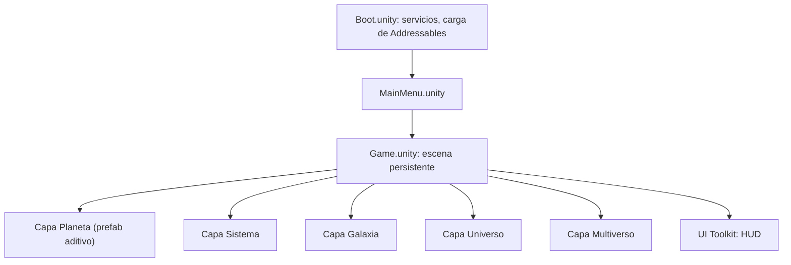
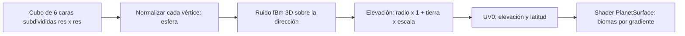
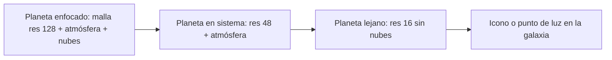

# 05 · Escenografía y generación procedural

Este documento explica cómo se construyen las **escenas** (planeta, sistema, galaxia, universo, multiverso) y cómo se **generan** sus contenidos con código. El código de referencia está en [`codigo/Generation`](codigo/Generation) y [`codigo/Shaders`](codigo/Shaders).

## 1. Principios

1. **Procedural donde hay escala, artesanal donde hay emoción.** Los planetas, sistemas y galaxias son procedurales. Los dioses, los momentos de historia, la interfaz y los "planetas capital" de la historia se hacen a mano (o con procedural retocado y guardado como asset).
2. **Datos y vista separados.** Los generadores producen **datos** (`Multiverse`, `StarSystem`...) y **mallas**. Las vistas (MonoBehaviour) los instancian. Una misma semilla da siempre los mismos datos.
3. **Shaders en lugar de texturas.** Un planeta usa 1 textura gradiente de 256×1 en lugar de un atlas de 2048. El color y el detalle salen del ruido y de la elevación.
4. **Presupuesto antes que belleza.** Cada efecto tiene un coste medido en ms en el dispositivo de referencia (ver [09_rendimiento_y_optimizacion_movil.md](09_rendimiento_y_optimizacion_movil.md)).

## 2. Organización de escenas



- Hay **una sola escena de juego** con capas que se activan según el zoom. No se cargan escenas al hacer zoom; solo se activan o desactivan *roots* y se cambia el LOD.
- El contenido de cada universo (paleta, skybox, especies, música) se carga por Addressables con la etiqueta `rules.addressablesLabel` al entrar en ese universo, y se libera al salir.
- Las **escenas de historia** (cinemáticas cortas) son escenas aditivas pequeñas con Timeline y Cinemachine.

### 2.1 Escalas y precisión numérica

El float de 32 bits pierde precisión a partir de ~10⁵ unidades. Por eso **cada capa tiene su propia escala**:

| Capa | 1 unidad de Unity = | Rango visible |
|---|---|---|
| Planeta | 1 radio planetario / 1 | 0,5–20 u |
| Sistema | 1 UA / 10 | 1–600 u |
| Galaxia | 1 año luz / 1000 | 10–300 u |
| Universo | 1 galaxia ≈ 100 u | 100–2000 u |
| Multiverso | 1 universo ≈ 200 u | Burbujas en un plano |

Al pasar de una capa a otra, el objeto enfocado se convierte en el **origen** de la nueva capa (*floating origin*).

## 3. Planetas

### 3.1 Malla: esfera cubo-normalizada



Ventajas frente a una UV-sphere: densidad uniforme (sin polos pinchados), 6 caras independientes que se pueden convertir en *chunks* con LOD propio y triángulos cacheables por resolución.

Fragmento clave ([`PlanetMeshGenerator.cs`](codigo/Generation/PlanetMeshGenerator.cs)), ejecutado en un **job Burst paralelo**:

```csharp
GetFaceAxes(face, out float3 up, out float3 axisA, out float3 axisB);
float2 percent = new float2(x, y) / (resolution - 1);
float3 pointOnCube = up + (percent.x - 0.5f) * 2f * axisA + (percent.y - 0.5f) * 2f * axisB;
float3 pointOnSphere = math.normalize(pointOnCube);

float n = Fbm(pointOnSphere * settings.frequency + settings.noiseOffset);       // 0..1
float land = math.max(0f, n - settings.seaLevel) / (1f - settings.seaLevel);    // océano plano
positions[index] = pointOnSphere * settings.radius * (1f + land * settings.elevationScale);
uvs[index] = new float2(n, math.abs(pointOnSphere.y));                           // bioma y latitud
```

**fBm (fractal Brownian motion):** se suman *octavas* de ruido simplex, cada una con el doble de frecuencia (`lacunarity ≈ 2`) y la mitad de amplitud (`persistence ≈ 0,5`):

```csharp
for (int o = 0; o < octaves; o++)
{
    sum += noise.snoise(p * frequency) * amplitude;
    norm += amplitude; amplitude *= persistence; frequency *= lacunarity;
}
return sum / norm * 0.5f + 0.5f;
```

Variantes de ruido por tipo de planeta:

| Tipo | Ruido | Truco |
|---|---|---|
| Rocoso / oceánico | fBm simplex de 5 octavas | `seaLevel` 0,4–0,55 |
| Desértico | fBm + *ridged* (`1 - abs(snoise)`) | Dunas: ruido estirado en un eje |
| Volcánico | Ridged multifractal | Emisivo en las grietas (elevación baja → lava) |
| Helado | fBm suave, 3 octavas | `_PolarCap` bajo |
| Gigante gaseoso | **Sin relieve**: esfera lisa y bandas en el shader | `sin(latitud × bandas + ruido)` |
| Exótico (Fulgor) | Domain warping: `fbm(p + fbm(p))` | Emisivo total animado con `_Time` |

**Resoluciones por LOD:**

| Distancia | `resolution` | Vértices | Uso |
|---|---|---|---|
| Cerca (capa Planeta) | 128 | 98 304 | Planeta enfocado, uno a la vez |
| Media (capa Sistema) | 48 | 13 824 | Planetas del sistema |
| Lejos | 16 | 1 536, o impostor | Sistema lejano y galaxia |

Generar un planeta de resolución 128 con Burst cuesta unos 3–6 ms en un móvil de gama media. Se puede hacer al vuelo y cachear (`Mesh` reutilizado, parámetro `reuse`).

**Versión sin Burst.** El cuerpo de `Execute` se puede copiar en un bucle `for` normal con `Vector3` y `Mathf.PerlinNoise` (2D; para 3D se combina el ruido de 3 planos) para depurar. Pasar a Burst solo requiere: tipos `Unity.Mathematics`, `NativeArray`, `[BurstCompile]` y `IJobParallelFor`, sin tipos gestionados (`class`, `string`, arrays C#) dentro del job.

### 3.2 Superficie y biomas

Shader [`PlanetSurface.shader`](codigo/Shaders/PlanetSurface.shader):

- `UV0.x` (elevación) muestrea una **textura gradiente de biomas** (256×1, *Clamp*, sin mipmaps): océano profundo → somero → playa → llanura → bosque → roca → nieve.
- `UV0.y` (latitud) añade **casquetes polares**.
- Lambert cuantizado en `_Bands` niveles (toon), especular solo en océanos y **luces de ciudades** en el lado nocturno si el planeta tiene civilización (`_CityLights`, controlado desde la vista con un material por planeta, ya que un `MaterialPropertyBlock` rompería el SRP Batcher; ver [09](09_rendimiento_y_optimizacion_movil.md)).

**Shader Graph equivalente (para artistas):** UV0 → Split → R → *Sample Texture 2D* (Gradient) → Lerp con color polar (G con Smoothstep) → *Custom Function* de Lambert en bandas → Base Color. Se usa el target **URP Unlit** con la iluminación calculada a mano para controlar el coste.

**Gradiente por universo.** Cada `UniverseRules` referencia (en la capa de presentación) un `Gradient` que un script del editor hornea a una textura de 256×1. Resonancia usa lilas y platas y Fulgor naranjas y blancos emisivos.

### 3.3 Atmósfera (rim / fresnel)

Shader [`PlanetAtmosphere.shader`](codigo/Shaders/PlanetAtmosphere.shader), aplicado a una esfera un 4–6 % mayor:

```hlsl
half fresnel = pow(1.0h - saturate(dot(N, V)), _FresnelPower);       // halo en el borde
half ndl = dot(N, mainLight.direction);
half dayMask = saturate(ndl * 0.5h + 0.5h);                           // atenuar el lado nocturno
half terminator = 1.0h - saturate(abs(ndl) / _TerminatorWidth);       // banda de atardecer
half3 color = lerp(_AtmosphereColor.rgb, _SunsetColor.rgb, terminator * 0.7h);
return half4(color * mainLight.color, saturate(fresnel * _Intensity * lerp(1, dayMask, _SunInfluence)));
```

Usa mezcla aditiva (`Blend SrcAlpha One`), sin texturas y sin escritura de profundidad. El coste es de una pasada transparente sobre unos pocos píxeles de borde.

### 3.4 Nubes

- **Opción ligera (por defecto):** otra esfera un 1–2 % mayor con un shader *Unlit Transparent* que muestrea ruido 3D horneado en una textura **cubemap de 256** (o en 2 texturas 2D con proyección triplanar barata) y rota más rápido que el planeta.
- **Opción media:** sombras de nubes en la superficie, muestreando la misma textura en `PlanetSurface` con un *offset*.
- Se evita el *ray marching* volumétrico: es demasiado caro en móvil.

### 3.5 Anillos

Un **anillo plano** (malla de anillo de 64 segmentos) con un shader que muestrea una textura 1D de bandas por radio (`length(uv - 0.5)`), con alfa recortada y una sombra del planeta calculada analíticamente (proyección de la esfera sobre el plano del anillo). Se generan si `type == GiganteGaseoso` y `rng.Chance(0.4)`, o siempre en Ascendia, donde los "planetas-anillo" son la norma.

## 4. Sistemas solares

Generador: [`StarSystemGenerator.cs`](codigo/Generation/StarSystemGenerator.cs).

### 4.1 Estrella por tipo espectral

| Tipo | Temperatura (K) | Masa (M☉) | Color | Peso por defecto |
|---|---|---|---|---|
| O | 30 000–45 000 | 16–40 | Azul | 0,01 |
| B | 10 000–30 000 | 2,1–16 | Azul-blanco | 0,03 |
| A | 7 500–10 000 | 1,4–2,1 | Blanco | 0,06 |
| F | 6 000–7 500 | 1,04–1,4 | Blanco-amarillo | 0,12 |
| G | 5 200–6 000 | 0,8–1,04 | Amarillo | 0,18 |
| K | 3 700–5 200 | 0,45–0,8 | Naranja | 0,25 |
| M | 2 400–3 700 | 0,08–0,45 | Rojo | 0,35 |

Relaciones aproximadas: radio ≈ M^0,8, luminosidad ≈ M^3,5 y **zona habitable** ≈ √L UA. Los pesos se pueden cambiar por universo con `UniverseRules.spectralWeights` (Fulgor favorece O/B).

**Render de la estrella:** esfera con un shader emisivo animado (ruido de granulación + *limb darkening* `pow(dot(N,V), k)`), un *billboard* de corona con un gradiente radial y un *lens flare* (URP Lens Flare SRP, 1 elemento) solo en calidad alta.

### 4.2 Órbitas keplerianas simplificadas

- Espaciado de tipo Titius-Bode: `a(n+1) = a(n) × U(1,4; 2,0)`.
- Periodo (3.ª ley de Kepler): `T = sqrt(a³ / (M · G_universo))` años, convertido a ciclos de juego: `turnos = T × 4 / timeFlowRate`.
- Posición: se resuelve la **ecuación de Kepler** `M = E − e·sin E` con Newton-Raphson (5 iteraciones):

```csharp
float meanAnomaly = 2f * Mathf.PI * (orbit.phase + timeTurns / orbit.periodTurns);
float E = meanAnomaly;
for (int i = 0; i < 5; i++)
    E -= (E - e * Mathf.Sin(E) - meanAnomaly) / (1f - e * Mathf.Cos(E));
float x = a * (Mathf.Cos(E) - e);
float z = a * Mathf.Sqrt(1f - e * e) * Mathf.Sin(E);
```

- La excentricidad se limita a 0–0,2 para que las órbitas se lean bien en pantalla. La inclinación es de ±4°.
- **Interpolación entre ciclos.** Las órbitas avanzan con el número de turno, y durante la animación de resolución se interpola `timeTurns` de `t` a `t+1` (las órbitas se mueven mientras "pasa el tiempo").
- **Escala visual distinta de la escala física.** En pantalla se usa `distancia_visual = sqrt(a) × k` para que los planetas exteriores no queden fuera de la cámara.
- Las líneas de órbita son un `LineRenderer` de 128 puntos o, mejor, una malla de anillo con un shader que dibuja una línea fina con *fade* por la cámara.

### 4.3 Reglas físicas en la vista

| Universo | Efecto visual en el sistema |
|---|---|
| Ascendia | Órbitas reflejadas en Y; estela de escombros alejándose de la estrella |
| Cronalis | *Trail renderer* con las posiciones pasadas; los planetas dejan 2–3 "fantasmas" |
| Teseracto | Las órbitas se deforman con una rotación 4D (vertex shader) |
| Resonancia | Ondas de anillo cada vez que un planeta cruza el periapsis |
| Thalassa | Las órbitas oscilan (`y += sin(t) × 0,1`); partículas de corriente |
| Oniria | La órbita cambia de forma lentamente (interpolación entre 2 elipses) |

## 5. Galaxias

Generador: [`GalaxyGenerator.cs`](codigo/Generation/GalaxyGenerator.cs).

**Espiral logarítmica:** `r = a · e^(bθ)`. Cada brazo se desfasa `2π / brazos`. La dispersión es gaussiana y crece con el radio, y el grosor vertical disminuye hacia los bordes.

```csharp
float theta = t * thetaMax;                       // t sesgado hacia el centro (bulbo denso)
float r = a * Mathf.Exp(pitch * theta);
float angle = theta + arm * (2f * Mathf.PI / arms);
Vector3 p = new Vector3(Mathf.Cos(angle) * r, 0f, Mathf.Sin(angle) * r);
p.x += rng.Gaussian(0f, spread * 0.5f);
p.z += rng.Gaussian(0f, spread * 0.5f);
p.y  = rng.Gaussian(0f, thickness * radius * (1f - t * 0.7f));
```

Hay **dos capas de puntos**:

| Capa | Cantidad | Datos de juego | Render |
|---|---|---|---|
| Sistemas jugables | 6–14 por galaxia | Sí (`StarSystem`) | Sprite de estrella interactivo + icono de dueño |
| Polvo y estrellas de fondo | 5 000–20 000 | No | Una sola malla de puntos (*quads* en un `Mesh`) o `Graphics.RenderMeshInstanced`; 1 draw call |

Para el polvo se llama a `GenerateSpiralPoints(rng, 15000, arms, radius, minSeparation: 0)` y se colorea por radio (núcleo amarillo, brazos azulados y nebulosas rosas en puntos aleatorios de los brazos). El resultado se guarda en una **malla estática** al generar la galaxia; no se usan partículas vivas.

**Impostor de galaxia** (capas Universo y Multiverso): se renderiza la galaxia una vez a una `RenderTexture` de 512² y se usa como *billboard* con rotación. Con 2–6 galaxias por universo esto cuesta casi cero.

## 6. Universos, multiverso y fondos

- **Skybox por universo:** un shader procedural de *skybox* (sin cubemap grande): gradiente de 2–3 colores de la paleta, estrellas de ruido celular (*Voronoi*) con umbral y **nebulosas** con fBm de 4 octavas y *domain warping* muestreado en dirección 3D. Se puede hornear a un cubemap de 512–1024 al entrar en el universo para que el coste por frame sea de un solo `texCUBE`.
- **Multiverso:** 7 "burbujas" (esferas con fresnel iridiscente y un impostor del contenido dentro) unidas por **hilos del Telar** (líneas con un shader de energía animado). La Marea de Nihil es un plano con un shader de *dissolve* que avanza desde el borde.
- **Nebulosas cercanas:** 3–6 *quads* grandes con una textura de nebulosa pintada (512², alfa suave) y *parallax* por capas. Es más barato y más bonito que las partículas.

## 7. Iluminación

| Elemento | Configuración |
|---|---|
| Luz principal | 1 *Directional Light* orientada desde la estrella enfocada hacia la cámara (se actualiza al cambiar de foco). Sombras solo en la capa Planeta y en cinemáticas. |
| Luces adicionales | Como máximo 2 por píxel (URP *Forward+* desactivado en gama baja; *Forward* con *Per Vertex* para luces adicionales en gama baja). |
| Ambiente | *Spherical Harmonics* desde el color del skybox del universo (`SampleSH` en los shaders). |
| Sombras | Cascada única, 1024 en gama media y desactivadas en gama baja (el toon sigue leyéndose bien). |
| Emisivos | HDR + Bloom: la principal fuente de espectacularidad. |

## 8. Post-proceso móvil (URP Volume)

| Efecto | Gama alta | Gama media | Gama baja | Coste aprox. |
|---|---|---|---|---|
| Bloom (*High Quality Filtering* desactivado, *Downscale* a la mitad) | Sí | Sí, 4 iteraciones | Sí, 2 iteraciones | 0,6–1,5 ms |
| Tonemapping (ACES o Neutral) | Sí | Sí | Sí | ~0,1 ms |
| Color Adjustments / LUT por universo | Sí | Sí | Sí | ~0,1 ms |
| Vignette | Sí | Sí | No | ~0,1 ms |
| Chromatic Aberration | Solo en milagros | No | No | — |
| Depth of Field (Gaussian) | Solo en diálogos | No | No | 1–2 ms |
| SSAO | No | No | No | Demasiado caro |
| Anti-aliasing | MSAA 4x | MSAA 2x | FXAA o nada | — |

Se usa **un único Volume global por universo** (perfil en Addressables) y Volumes locales solo para milagros (interpolación de `weight` con DOTween).

## 9. LOD e impostores (resumen)



- Los impostores de planetas se hacen con una cámara auxiliar que renderiza el planeta a una `RenderTexture` de 128² una vez por cambio de estado (dueño, bioma).
- Las unidades lejanas son iconos instanciados (`Graphics.RenderMeshInstanced` con una malla *quad* y un atlas).
- Todo lo que está fuera de la capa activa se **desactiva** (no basta con ocultarlo) para no pagar el coste de culling y de `Update`.

## 10. Herramientas del editor recomendadas

| Herramienta | Función |
|---|---|
| `ProceduralPlanet` con `[ExecuteAlways]` | Editar el planeta en vivo en la escena |
| *Planet Baker* (EditorWindow) | Hornear un planeta "capital" a un asset `.mesh` + textura para retocarlo a mano |
| *Seed Explorer* (EditorWindow) | Generar el multiverso con una semilla y listar estadísticas (planetas habitables, distribución de estrellas) para QA |
| *Gradient → Texture* | Hornear los gradientes de biomas a texturas de 256×1 |
| Gizmos | Dibujar órbitas y zonas habitables en la Scene View con `OnDrawGizmos` |
