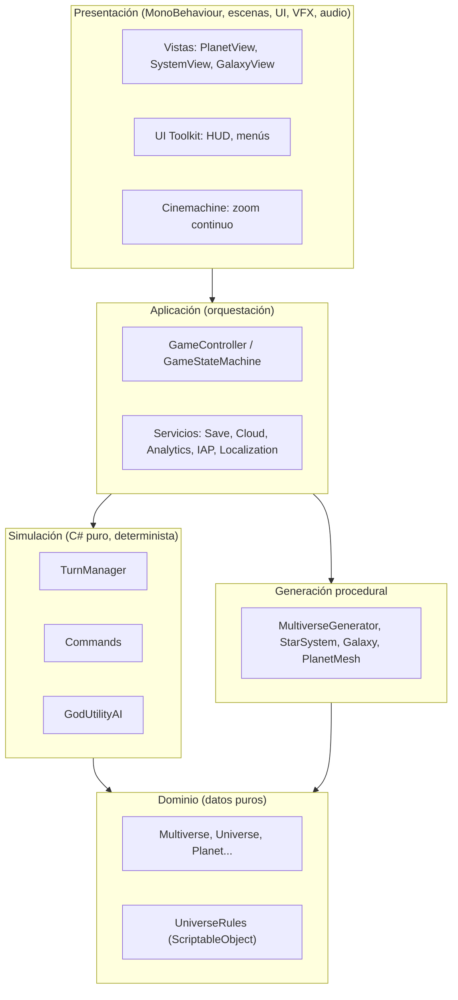
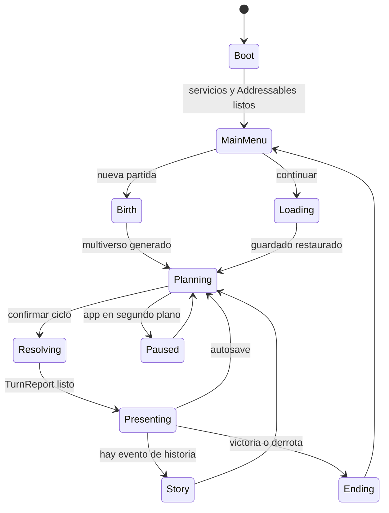
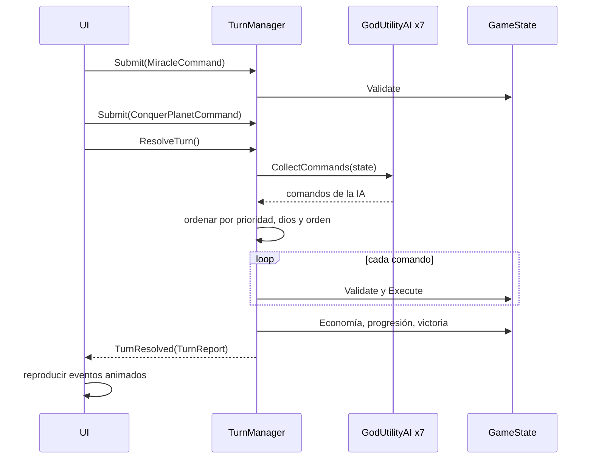
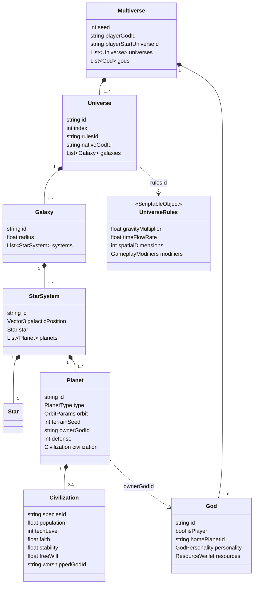
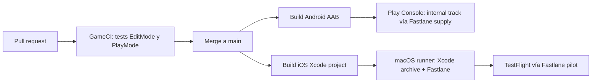

# 06 · Arquitectura técnica

## 1. Visión general por capas



**Regla de dependencias:** las flechas solo apuntan hacia abajo. La simulación **no conoce** Unity más allá de `Mathf` y los ScriptableObject de datos. Se puede ejecutar en tests de modo Edit y en simulaciones headless de miles de partidas. La presentación se suscribe a eventos (`TurnManager.TurnResolved`) y nunca modifica el modelo directamente, sino que envía **comandos**.

## 2. Estructura de carpetas del proyecto Unity

```text
Assets/
  _Game/
    Code/
      Domain/            GodGame.Domain.asmdef       (modelo, UniverseRules, RandomExtensions)
      Generation/        GodGame.Generation.asmdef   (generadores, Burst)
      Simulation/        GodGame.Simulation.asmdef   (GameState, TurnManager, Commands/)
      AI/                GodGame.AI.asmdef
      Save/              GodGame.Save.asmdef
      Presentation/      GodGame.Presentation.asmdef (vistas, cámara, VFX, audio)
      UI/                GodGame.UI.asmdef
      App/               GodGame.App.asmdef          (bootstrap, máquina de estados, servicios)
      Editor/            GodGame.Editor.asmdef       (solo Editor: herramientas, AssetPostprocessors)
    Data/
      Universes/         UR_Ascendia.asset ... UR_Oniria.asset
      Gods/              GodProfile_*.asset (retratos, voces, textos)
      Species/           Species_*.asset
      Balance/           BalanceConfig.asset (valores sobrescribibles por Remote Config)
    Art/
      Characters/<Universo>/<Personaje>/...
      Environment/ Planets/ Stars/ Skyboxes/ VFX/
    Shaders/             PlanetSurface, PlanetAtmosphere, ToonCharacter, SubGraphs/
    Audio/               FMOD banks / Unity Audio
    Localization/        String Tables (es, en, ...)
    Scenes/              Boot, MainMenu, Game, Story_*
    AddressableAssetsData/
  Tests/
    EditMode/            GodGame.Tests.EditMode.asmdef
    PlayMode/            GodGame.Tests.PlayMode.asmdef
```

### 2.1 Assemblies (.asmdef)

| Assembly | Referencias | Motivo |
|---|---|---|
| `GodGame.Domain` | — | Base, sin dependencias |
| `GodGame.Generation` | Domain, Unity.Burst, Unity.Mathematics, Unity.Collections | Burst solo donde hace falta |
| `GodGame.Simulation` | Domain | Lógica de juego testeable |
| `GodGame.AI` | Domain, Simulation | La IA solo produce comandos |
| `GodGame.Save` | Domain, Simulation | Serialización |
| `GodGame.Presentation` | Domain, Simulation, Generation, Cinemachine, DOTween, Unity.InputSystem | Vista |
| `GodGame.UI` | Domain, Simulation, Presentation, Unity.Localization | HUD |
| `GodGame.App` | Todo lo anterior + UGS, Unity IAP | Composición (punto de arranque) |
| `GodGame.Editor` | Todo + UnityEditor | Solo en `includePlatforms: [Editor]` |
| `GodGame.Tests.EditMode` | Domain, Simulation, AI, Generation, Save + nunit | Tests |

Beneficios: compilación incremental más rápida, dependencias circulares imposibles (Unity las rechaza) y la seguridad de que la simulación no use `MonoBehaviour` por accidente. Los `.asmdef` de ejemplo están en [`codigo/`](codigo/).

## 3. Patrones

### 3.1 ScriptableObjects como datos

- `UniverseRules`, `GodProfile`, `SpeciesDefinition`, `MiracleDefinition`, `BalanceConfig`.
- Son **inmutables en runtime**. Para variaciones (Remote Config, dificultad) se hace `Instantiate(asset)` y se modifica la copia.
- Se referencian por **id string estable** en los datos serializados y por referencia directa en el editor.

### 3.2 Máquina de estados del juego



Implementación: una clase `GameStateMachine` con estados `IGameState { Enter(); Tick(); Exit(); }`. Al entrar en `Paused` (evento `OnApplicationPause(true)`) se guarda **siempre**, porque iOS y Android pueden matar la app sin aviso.

### 3.3 Command pattern para turnos



- `ICommand { GodId, Priority, Validate, Execute }` ([`codigo/Simulation/Commands/ICommand.cs`](codigo/Simulation/Commands/ICommand.cs)).
- La lista de comandos de cada ciclo se puede **serializar**. Esto sirve para replays, informes de bugs ("adjunta tu partida": semilla + comandos) y PvP asíncrono (se intercambian solo los comandos).

### 3.4 Eventos

- **Simulación → presentación:** `TurnReport` con una lista de `TurnEvent`. La presentación los reproduce en secuencia: cámara a ese planeta, VFX y sonido.
- **Presentación interna:** canales de eventos basados en ScriptableObject (`GameEventChannel<T>`) para desacoplar UI, audio y VFX sin singletons.
- Se evitan `UnityEvent` en el código caliente (generan basura). Se usan `event Action<T>`.

## 4. Modelo de datos



Código: [`codigo/Domain/MultiverseModel.cs`](codigo/Domain/MultiverseModel.cs). Todas las relaciones "de uso" (dueño, dios adorado, reglas) son **ids**, nunca referencias. Esto evita ciclos al serializar y permite reconstruir índices (`GameState.RebuildIndices`).

## 5. Determinismo por semilla

| Fuente de azar | Cómo se hace determinista |
|---|---|
| Generación | `System.Random` con `DeriveSeed(seed, etiqueta)` por universo y por jugador |
| Terreno | `Planet.terrainSeed` → `noiseOffset` (Unity.Mathematics.Random) |
| Turnos (combate, herejías) | `GameState.CreateTurnRandom(salt)` = f(seed, turno, etiqueta) |
| IA | `CreateTurnRandom("ai:" + godId)` |
| Orden de resolución | Prioridad → `GodId` (ordinal) → orden de envío |

**Consecuencias:**
- No hace falta guardar el estado de ningún generador aleatorio.
- La "previsualización de ciclo" de Cronalis es exacta: se clona el estado y se resuelve.
- **Advertencia sobre float:** el determinismo es completo en un mismo binario y plataforma. Entre plataformas (ARM y x86) pueden aparecer diferencias mínimas de float. Para PvP asíncrono, el servidor (o el cliente que resuelve) es la **autoridad**, y los otros reciben el resultado y no lo vuelven a simular. Si se necesitara un *lockstep* real, se migraría la simulación a punto fijo (`int` × 1000).
- **No usar** `UnityEngine.Random`, `string.GetHashCode()` ni el orden de iteración de `Dictionary` o `HashSet` en lógica que afecte al resultado.

## 6. Guardado

Código: [`codigo/Save/SaveSystem.cs`](codigo/Save/SaveSystem.cs).

| Aspecto | Decisión |
|---|---|
| Formato | JSON (`JsonUtility`) dentro de un sobre `{version, checksum, payload}`. Si el tamaño pasa de ~2 MB o el guardado tarda más de 50 ms: **MessagePack-CSharp** (binario y unas 5 veces más rápido), manteniendo la API. |
| Ubicación | `Application.persistentDataPath/saves/slot_N.json`, con 3 slots + autosave |
| Atomicidad | Se escribe en `.tmp` y se hace `File.Replace` con `.bak`. Al cargar, si falla el checksum se intenta el `.bak`. |
| Versionado | `CurrentVersion` + migraciones encadenadas `v1 → v2 → …` |
| Cuándo | Autosave al final de cada ciclo, en `OnApplicationPause(true)` y al salir de una escena de historia |
| Nube | **Unity Cloud Save**: se sube el string del sobre al guardar el autosave (como mucho cada 5 min). Conflictos: gana el `savedAtUtc` más reciente y se pregunta al usuario si la diferencia es de más de 10 ciclos. |
| Optimización futura | Guardar **semilla + deltas** (planetas modificados) en lugar del multiverso completo |

Ejemplo de Cloud Save (paquete `com.unity.services.cloudsave`):

```csharp
using System.Collections.Generic;
using Unity.Services.CloudSave;

public static async System.Threading.Tasks.Task UploadAsync(string envelopeJson)
{
    var data = new Dictionary<string, object> { { "autosave", envelopeJson } };
    await CloudSaveService.Instance.Data.Player.SaveAsync(data);
}
```

## 7. IA

- **Utility AI** para la estrategia ([`codigo/AI/GodUtilityAI.cs`](codigo/AI/GodUtilityAI.cs)). Se ejecuta durante la resolución, con un coste aproximado de 0,5–2 ms por dios y ciclo con unos 300 planetas. Si crece: se ejecuta en un `Task` (la simulación es C# puro y no toca la API de Unity) mientras la UI muestra la animación de "los dioses deliberan".
- **Árboles de comportamiento** (o *Unity Behavior*, el paquete oficial) solo para guiones de historia, como "Aeterna traiciona en el capítulo 11".
- **Depuración:** un panel de editor que muestra las 10 mejores opciones con su puntuación desglosada por consideración.

## 8. Localización

- Paquete **Unity Localization**, con *String Tables* `UI`, `Story`, `Codex` y `Events`, y *Asset Tables* para audio y texturas con texto.
- Idiomas: **ES (fuente) y EN** en el lanzamiento. Después PT-BR, FR, DE, JA, KO y ZH-Hans (fuentes con TextMeshPro o UI Toolkit y *fallback* de fuentes CJK descargado vía Addressables).
- La simulación produce **claves** (`messageKey = "conquest.cultural.success"`), nunca texto.
- Plurales y variables con *Smart Strings*: `{god} ha convertido {count:plural:un planeta|{} planetas}`.
- Pseudolocalización activada en QA para detectar texto sin localizar y desbordamientos.

## 9. Analítica

**Unity Analytics** (UGS) con eventos propios. Se piden permisos y consentimiento según la región (GDPR/CCPA) **antes** de enviar.

| Evento | Parámetros | Para qué |
|---|---|---|
| `game_started` | seed, startUniverse, difficulty | Distribución del azar |
| `turn_completed` | turn, stage, universeId, sessionTurn | Ritmo de las sesiones |
| `conquest` | type, success, universeId, turn | Balance de las vías |
| `miracle_cast` | type, universeId | Uso de milagros |
| `stage_reached` | stage, turn | Embudo de progresión |
| `chapter_completed` | chapter, durationMin | Ritmo de la historia |
| `tutorial_step` | step, skipped | Embudo de onboarding |
| `ending_reached` | ending, turn | Distribución de finales |
| `iap_purchase` | productId, price, currency | Monetización (además de la validación de la tienda) |

**Crashlytics** (Firebase) para fallos nativos y excepciones C#, con *breadcrumbs* del estado de la máquina de estados.

## 10. CI/CD



| Opción | Pros | Contras |
|---|---|---|
| **Unity Build Automation** | Integrado, con máquinas macOS incluidas | Coste por minuto de build |
| **GitHub Actions + GameCI** | Flexible, gratis en repos públicos y con minutos incluidos en privados | Requiere runner macOS para iOS (los de GitHub cuestan unas 10 veces más por minuto) y gestión de la licencia de Unity |

Recomendación: **GameCI en GitHub Actions** para tests y builds de Android, y **Unity Build Automation o un Mac mini propio** como runner para iOS.

Ejemplo mínimo (`.github/workflows/build.yml`):

```yaml
name: build
on:
  push: { branches: [ main ] }
  pull_request:
jobs:
  test:
    runs-on: ubuntu-latest
    steps:
      - uses: actions/checkout@v4
        with: { lfs: true }
      - uses: actions/cache@v4
        with: { path: Library, key: Library-${{ hashFiles('Packages/packages-lock.json') }} }
      - uses: game-ci/unity-test-runner@v4
        env:
          UNITY_LICENSE: ${{ secrets.UNITY_LICENSE }}
          UNITY_EMAIL: ${{ secrets.UNITY_EMAIL }}
          UNITY_PASSWORD: ${{ secrets.UNITY_PASSWORD }}
        with: { testMode: all }
  android:
    needs: test
    if: github.ref == 'refs/heads/main'
    runs-on: ubuntu-latest
    steps:
      - uses: actions/checkout@v4
        with: { lfs: true }
      - uses: game-ci/unity-builder@v4
        env:
          UNITY_LICENSE: ${{ secrets.UNITY_LICENSE }}
          UNITY_EMAIL: ${{ secrets.UNITY_EMAIL }}
          UNITY_PASSWORD: ${{ secrets.UNITY_PASSWORD }}
        with:
          targetPlatform: Android
          androidExportType: androidAppBundle
          androidKeystoreName: release.keystore
          androidKeystoreBase64: ${{ secrets.ANDROID_KEYSTORE_BASE64 }}
          androidKeystorePass: ${{ secrets.ANDROID_KEYSTORE_PASS }}
          androidKeyaliasName: ${{ secrets.ANDROID_KEYALIAS_NAME }}
          androidKeyaliasPass: ${{ secrets.ANDROID_KEYALIAS_PASS }}
      - uses: actions/upload-artifact@v4
        with: { name: android-aab, path: build/Android }
```

**Secretos:** keystore, certificados, la API key de App Store Connect y la cuenta de servicio de Google Play van **siempre** en *GitHub Secrets* o en un vault, nunca en el repositorio. Para iOS, **Fastlane match** guarda los certificados cifrados en un repositorio privado.

**Fastlane** (`fastlane/Fastfile`, resumido):

```ruby
platform :ios do
  lane :beta do
    match(type: "appstore", readonly: true)
    build_app(project: "build/iOS/Unity-iPhone.xcodeproj", scheme: "Unity-iPhone", export_method: "app-store")
    upload_to_testflight(skip_waiting_for_build_processing: true)
  end
end

platform :android do
  lane :internal do
    upload_to_play_store(track: "internal", aab: "build/Android/GodGame.aab", json_key: ENV["PLAY_JSON_KEY_PATH"])
  end
end
```

## 11. Control de versiones

- **Git + Git LFS** (`*.psd`, `*.fbx`, `*.png`, `*.wav`, `*.blend`...) o **Unity Version Control** si hay muchos artistas (bloqueo de archivos binarios).
- Unity: *Asset Serialization* en **Force Text** y *Version Control Mode* en **Visible Meta Files**. `.gitignore` oficial de Unity.
- Ramas: `main` (siempre se puede compilar), `feature/*` y `release/x.y`. Versión semántica `x.y.z` + *build number* incremental en CI (`bundleVersionCode` / `CFBundleVersion`).
