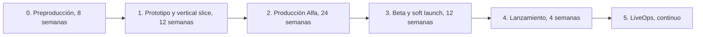
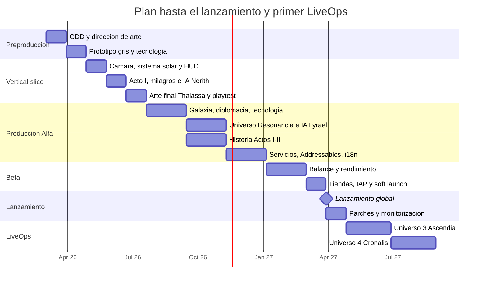

# 07 · Plan de trabajo y cronograma

## 1. Definición de MVP

**Se lanza con poco y se añade el resto en actualizaciones.** Siete universos completos desde el día 1 multiplicarían por 3,5 el contenido de arte, audio y escritura, y retrasarían el lanzamiento más de un año.

| Incluido en el MVP (v1.0) | Fuera del MVP (actualizaciones) |
|---|---|
| **2 universos jugables completos**: Thalassa (lectura sencilla, buen tutorial) y Resonancia (contraste visual y mecánico) | Universos 3–7 (de 2 en 2 o de 1 en 1 cada 8–10 semanas) |
| Prólogo, Acto I y Acto II completos; Acto III parcial (el Velo entre los 2 universos) | Actos III–IV completos y los 4 finales (con el último universo) |
| 3 vías de conquista, 4 milagros base, árbol divino de 3 niveles | Coronas de Ley de los universos 3–7 |
| IA con 2 personalidades completas (Nerith, Lyrael) | Las 5 personalidades restantes |
| Escaramuza en 1 universo con semilla libre | PvP asíncrono |
| ES + EN | Más idiomas |
| Guardado local + Cloud Save, Analytics, Crashlytics, Remote Config | Rankings de semilla y retos diarios |
| Desbloqueo de la campaña (IAP único) y 1 paquete cosmético | Pase de temporada cosmético |

Mientras faltan universos, el universo inicial aleatorio elige entre los **disponibles**. Se comunica en la tienda como "nuevos universos gratis en cada actualización".

## 2. Fases

| Fase | Duración | Objetivo | Criterio de salida (*gate*) |
|---|---|---|---|
| 0 · Preproducción | 8 sem | GDD, dirección de arte, prototipo en papel y digital "gris", decisión técnica validada | Un ciclo de juego divertido con cubos grises; la guía de estilo está aprobada |
| 1 · Prototipo / vertical slice | 12 sem | **1 universo (Thalassa) a calidad final** durante 30 min: Acto I, cámara de zoom, 2 vías de conquista, 1 dios IA | Prueba con 10–15 jugadores externos: ≥ 70 % quiere seguir jugando; 30 fps en el dispositivo de gama baja |
| 2 · Producción Alfa | 24 sem | Todo el contenido del MVP: 2 universos, Actos I–II, sistemas completos | *Feature complete* y *content complete* del MVP; sin bugs bloqueantes |
| 3 · Beta / soft launch | 12 sem | Pulido, balance, rendimiento, tiendas; soft launch en 2–3 países (p. ej. Canadá, Filipinas, Países Bajos o Chile) | D1 ≥ 40 %, D7 ≥ 15 %, ≥ 99,5 % de sesiones sin crash |
| 4 · Lanzamiento | 4 sem | Lanzamiento global, ASO, prensa, comunidad | Publicado en ambas tiendas |
| 5 · LiveOps | Continuo | Universo nuevo cada 8–10 semanas, eventos, balance por Remote Config | Hoja de ruta trimestral |

**Duración total hasta el lanzamiento: unos 15 meses** con el equipo recomendado (sección 4). Con el equipo mínimo, unos 22–26 meses.

## 3. Sprints (2 semanas)

Las fechas son de ejemplo, con inicio el lunes 2 de marzo de 2026.

| Sprint | Fase | Entregables principales |
|---|---|---|
| S1 | Pre | GDD v1, moodboards de los 7 universos, proyecto Unity 6 URP con CI (GameCI) y tests de ejemplo pasando |
| S2 | Pre | Prototipo en papel del core loop (cartas), prototipo digital gris: `TurnManager` + comandos + economía (este repositorio de código) |
| S3 | Pre | Guía de estilo, concept del Octavo y de Nerith, shader toon y de planeta en prueba en dispositivo |
| S4 | Pre | Generador de multiverso + vista de planeta procedural; *gate* de preproducción |
| S5 | Proto | Cámara de zoom continuo planeta ↔ sistema (Cinemachine + Input System) |
| S6 | Proto | Sistema solar visual (órbitas, estrella, atmósfera); HUD de recursos (UI Toolkit) |
| S7 | Proto | Regiones del planeta (Acto I), Bendición, Profeta, conversión cultural |
| S8 | Proto | Primera IA (Nerith) con Utility AI; conquista militar y VFX de milagro |
| S9 | Proto | Arte final de Thalassa (skybox, gradientes, 2 especies), música adaptativa v1 |
| S10 | Proto | Guardado/carga, tutorial de los ciclos 0–10, *playtest* externo; **vertical slice** |
| S11–S12 | Alfa | Escala galáctica, generador de galaxia, coste por distancia, diplomacia básica (tregua y opinión) |
| S13–S14 | Alfa | Conquista tecnológica, árbol divino, mutaciones de especies |
| S15–S16 | Alfa | Universo Resonancia: arte, especies, reglas especiales (Afinación, luz lenta) |
| S17–S18 | Alfa | IA de Lyrael, escala universal, Coronas de Ley, Puerta del Velo |
| S19–S20 | Alfa | Historia: Actos I–II (diálogos, retratos en Spine, eventos procedurales con 60 plantillas) |
| S21–S22 | Alfa | Addressables por universo, descarga bajo demanda, Cloud Save, Analytics, Crashlytics |
| S23 | Alfa | Localización EN, accesibilidad, ajustes de calidad por dispositivo |
| S24 | Alfa | **Content complete**; congelación de funciones |
| S25–S26 | Beta | Simulaciones de balance (10 000 partidas headless), ajuste de Remote Config |
| S27–S28 | Beta | Rendimiento: 30 fps estables en gama baja y control de la térmica en sesiones de 15 min |
| S29–S30 | Beta | IAP, pantallas legales y de privacidad, fichas de tienda, **soft launch** |
| S31–S32 | Beta | Iteración según KPI (onboarding y retención) |
| S33–S34 | Lanz. | Lanzamiento global, monitorización, parches rápidos |
| S35+ | LiveOps | Universo 3 (Ascendia) a las 8–10 semanas del lanzamiento, y así sucesivamente |

## 4. Diagrama de Gantt

**Hitos:**

| Hito | Semana aprox. | Evidencia |
|---|---|---|
| H1 · Gate de preproducción | 8 | Vídeo del prototipo gris + GDD aprobado |
| H2 · Vertical slice | 20 | Build en TestFlight y Play internal; informe de playtest |
| H3 · Content complete MVP | 44 | Build Alfa con los 2 universos |
| H4 · Soft launch | 52 | Publicado en 2–3 países |
| H5 · Lanzamiento global | 60 | Publicado en todo el mundo |
| H6 · Primer universo nuevo | 70 | Actualización 1.1 |

## 5. Equipo

### 5.1 Equipo mínimo indie (3–4 personas + externos)

| Rol | Dedicación | Responsabilidades |
|---|---|---|
| Programador/a líder (Unity, C#) | 100 % | Arquitectura, simulación, IA, procedural, shaders, CI, publicación |
| Artista 3D/técnico generalista | 100 % | Concept, modelado, rig, animación, VFX, integración |
| Diseñador/a de juego y narrativa | 100 % | GDD, balance, historia, diálogos, niveles, UX, QA |
| Programador/a de UI y gameplay | 50–100 % | HUD, menús, tutorial, IAP, localización |
| Externos | Por encargo | Música y SFX (compositor freelance), retratos 2D (ilustrador), traducción EN, QA en dispositivos (servicio externo en beta) |

### 5.2 Equipo ideal (12–15 personas)

| Área | Roles |
|---|---|
| Dirección | Director/a de juego, productor/a |
| Programación (5) | Líder técnico, gameplay/simulación, IA, gráficos/tech art (shaders y rendimiento), herramientas/backend/CI |
| Arte (4–5) | Director/a de arte, concept artist, 3D personajes, 3D entornos/VFX, animador/a |
| Diseño (2) | Diseñador/a de sistemas (economía y balance), narrativo/a |
| UI/UX (1) | Diseño de interfaz móvil |
| Audio (1) | Diseñador/a de sonido y compositor/a (o externo) |
| QA (1–2) | Tests manuales y automatización, gestión de dispositivos |
| Comunidad y marketing (1) | ASO, redes, prensa |

## 6. Estimación de esfuerzo

Personas-mes para el MVP (2 universos).

| Área | Personas-mes | Notas |
|---|---|---|
| Programación de núcleo (simulación, IA, guardado, servicios) | 14 | |
| Programación de presentación (cámara, vistas, UI, VFX) | 12 | |
| Generación procedural y shaders | 5 | |
| Arte de personajes (8 dioses en concept, 2 dioses finales, unas 10 especies y unidades) | 14 | Unos 2–3 semanas por especie no humanoide |
| Arte de entornos (2 universos, skyboxes, planetas, VFX) | 8 | |
| Diseño, balance y narrativa | 12 | |
| Audio | 4 | Externo |
| QA | 6 | |
| Producción, ASO y comunidad | 6 | |
| **Total** | **~81 personas-mes** | Unas 5,5 personas durante 15 meses |

Cada universo adicional en LiveOps cuesta unas **8–10 personas-mes** (arte 5, diseño y narrativa 2, programación de reglas especiales 1,5, audio 1 y QA 0,5).

## 7. Costes aproximados

Precios orientativos en USD a la fecha de redacción. **Hay que comprobarlos antes de presupuestar**, porque cambian con frecuencia.

| Concepto | Coste | Periodicidad |
|---|---|---|
| Apple Developer Program | 99 | Anual |
| Google Play Console | 25 | Pago único |
| Unity Personal | 0 (si los ingresos o la financiación son menores de 200 000 al año) | — |
| Unity Pro (si se supera el umbral) | ~2 200 por puesto | Anual |
| Unity Gaming Services | 0 con los niveles gratuitos para el lanzamiento indie; después según uso | Mensual |
| Firebase Crashlytics | 0 | — |
| Blender, Krita, ArmorPaint | 0 | — |
| Adobe Substance 3D Painter | ~20–50/mes (suscripción) o licencia perpetua en Steam ~150–200 | Mensual o única |
| Spine Essential / Professional | ~70 / ~300–380 | Única por persona |
| FMOD | 0 (licencia indie con presupuesto menor de 200 000; consultar condiciones) | — |
| DOTween Pro (opcional) | ~15 | Única |
| Mac para builds de iOS (Mac mini) | ~600–1 000 | Única |
| Dispositivos de prueba (6–8, ver doc 10) | ~1 500–3 000 | Única |
| GitHub (Team) + Git LFS / runners | ~50–150 | Mensual |
| Música original (freelance, unos 40 min) | ~3 000–12 000 | Única |
| Ilustración de retratos (8 dioses) | ~2 000–6 000 | Única |
| Traducción EN (unas 60 000 palabras) | ~4 000–7 000 | Única |
| Marketing de lanzamiento (UA de prueba en el soft launch) | ~3 000–20 000 | Variable |

**Escenarios:**
- **Indie mínimo** (salarios aparte): unos 15 000–35 000 USD en herramientas, externos y marketing.
- **Salarios:** dependen del país. Para 81 personas-mes a 2 500–6 000 USD por persona y mes, entre 200 000 y 490 000 USD.

## 8. Riesgos y mitigaciones

| # | Riesgo | Prob. | Impacto | Mitigación |
|---|---|---|---|---|
| R1 | **Alcance excesivo** (7 universos) | Alta | Alto | MVP con 2 universos; el resto como actualizaciones; contenido modular por universo |
| R2 | El core loop no divierte | Media | Crítico | Prototipo en papel y gris antes de producir arte; *gate* en la semana 8 con jugadores externos |
| R3 | Rendimiento o térmica en gama baja | Media | Alto | Presupuestos desde el sprint 1, dispositivo de gama baja en cada revisión, perfiles de calidad |
| R4 | Balance roto entre universos o vías | Alta | Medio | Simulación determinista headless de miles de partidas; Remote Config |
| R5 | IA poco convincente o fácil de explotar | Media | Medio | Utility AI con depurador visual; playtests dirigidos a "romper" la IA |
| R6 | Rechazo en la revisión de tiendas (privacidad, IAP) | Media | Alto | Checklist del doc 08; TestFlight y Play internal desde el vertical slice |
| R7 | Cambios de licencia o de precio del motor | Baja | Medio | LTS fijada; dominio y simulación en C# puro y portable |
| R8 | Tamaño de descarga alto | Media | Medio | Addressables + Play Asset Delivery; base menor de 150 MB vigilada en CI |
| R9 | Dependencia de una sola persona clave | Media | Alto | Documentación (este repositorio), revisiones de código, pares en sistemas críticos |
| R10 | La trama se diluye en el sandbox | Media | Medio | Capítulos con objetivos claros y eventos guionizados en los hitos de escala |
| R11 | Visibilidad en las tiendas | Alta | Alto | ASO desde el soft launch, comunidad temprana (Discord, devlog), *wishlist* y preinscripción en Play |
| R12 | Uso de assets de IA con licencia dudosa | Media | Alto | Política: la IA solo en moodboards; revisión legal de cada asset final |

## 9. Ritmo de trabajo

- **Ceremonias:** planificación del sprint (2 h), *daily* de 15 min, revisión con build en dispositivo (1 h) y retrospectiva (45 min).
- **Definición de "Hecho":** compila en CI, tiene tests (en simulación), se ha probado en el dispositivo de gama baja, los textos están localizados con claves y el diseño lo ha validado.
- **Playtest interno** cada viernes de la segunda semana y **externo** cada 2 sprints a partir del S8.
- **Herramientas:** Jira, Linear o GitHub Projects (backlog), Notion o este repositorio (documentación) y Discord (equipo y comunidad).
