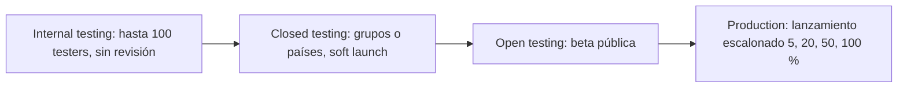

# 08 · Publicación en App Store y Google Play

> Las políticas de Apple y Google cambian varias veces al año. Antes de cada envío hay que revisar las **App Review Guidelines** de Apple, el **Policy Center** de Google Play y los requisitos de *target API level* vigentes.

## 1. Cuentas y requisitos previos

| Paso | Apple | Google |
|---|---|---|
| Cuenta | Apple Developer Program, **99 USD/año**. Como empresa hace falta un número **D-U-N-S**. | Google Play Console, **25 USD** de pago único. Cuenta de organización recomendada (las cuentas personales nuevas deben hacer una prueba cerrada con testers durante 14 días antes de producción). |
| Datos fiscales y bancarios | App Store Connect → Business (acuerdos, impuestos, banco). Sin esto no hay IAP. | Payments profile + Merchant account para vender |
| Verificación | 2FA en el Apple ID | Verificación de identidad y de dirección |
| Herramientas | Mac con Xcode (la versión que exija Apple en ese momento) | Android SDK y JDK que trae Unity |

## 2. Configuración en Unity (Player Settings)

| Ajuste | Android | iOS |
|---|---|---|
| Identificador | `com.estudio.aeon` (no se puede cambiar después) | El mismo *Bundle ID* |
| Versión | `bundleVersion` 1.0.0 + `bundleVersionCode` incremental | `Version` 1.0.0 + `Build` incremental |
| Scripting backend | **IL2CPP** | IL2CPP (obligatorio) |
| Arquitecturas | **ARM64** (ARMv7 opcional; Google exige 64 bits) | ARM64 |
| API mínima / objetivo | Min API 26 (Android 8). **Target: la que exija Google ese año** (normalmente la última o la penúltima). | iOS 15+ |
| Graphics API | Vulkan + OpenGLES3 como alternativa | Metal |
| Texturas | ASTC (con ETC2 como alternativa vía *Texture Compression Targeting* en AAB) | ASTC |
| Gestión de código | *Managed Stripping Level*: Medium/High con `link.xml` | Igual |
| Orientación | Landscape Left/Right | Landscape Left/Right |

## 3. Android: firma, App Bundle y Play Asset Delivery

### 3.1 Firma

1. Se crea el **upload keystore** en Unity (*Publishing Settings → Keystore Manager*) o con `keytool`:
   ```bash
   keytool -genkeypair -v -keystore upload.keystore -alias upload -keyalg RSA -keysize 2048 -validity 10000
   ```
2. Se activa **Play App Signing**: Google guarda la clave de firma final y nosotros solo la de subida. Si se pierde la de subida, se puede reiniciar mediante soporte.
3. El keystore y sus contraseñas se guardan en un **gestor de secretos** y en los secretos de CI, **nunca en el repositorio**. Hay que tener una copia de seguridad fuera de línea.

### 3.2 Android App Bundle (AAB) + Play Asset Delivery

- *Build Settings → Build App Bundle (Google Play)*.
- **Play Asset Delivery** con Addressables (*Android → Split Application Binary* o la integración de PAD en Addressables de Unity 6):

| Asset pack | Modo | Contenido | Tamaño objetivo |
|---|---|---|---|
| Base (AAB) | — | Código, UI, Boot, shaders, Thalassa y Resonancia en baja calidad | < 150 MB |
| `universe_thalassa`, `universe_resonancia` | **install-time** | Arte completo de los universos del MVP | ~80–120 MB cada uno |
| `universe_<resto>` | **on-demand** (o *fast-follow*) | Universos de actualizaciones | ~80–120 MB cada uno |
| `voices_<idioma>` | on-demand | Voces localizadas (si las hay) | Variable |

Límites a vigilar: el módulo base de un AAB no puede superar los 200 MB comprimidos, y los asset packs tienen límites propios. Conviene comprobarlos en la documentación de Play.

### 3.3 Tracks de prueba en Play Console



- Se usa **lanzamiento escalonado** (*staged rollout*): si la tasa de ANR o crash sube en Android Vitals, se detiene.
- **Android Vitals:** hay que mantener los ANR por debajo del 0,47 % y los crashes por debajo del 1,09 % (umbrales de "mal comportamiento" de Google) para no perder visibilidad.
- Se activa la **preinscripción** (*pre-registration*) varios meses antes del lanzamiento.

## 4. iOS: certificados, Xcode y TestFlight

### 4.1 Identificadores y firma

1. En *developer.apple.com → Certificates, IDs & Profiles*:
   - **App ID** explícito con las capacidades necesarias: In-App Purchase, Game Center (opcional), Sign in with Apple y Push (opcional).
   - Certificado **Apple Distribution**.
   - **Provisioning profile** *App Store* para el App ID.
2. Recomendado: **Fastlane match** genera y sincroniza certificados y perfiles cifrados en un repositorio privado, así todo el equipo y la CI usan los mismos.
3. En App Store Connect se crea la app (nombre, idioma principal, Bundle ID y SKU).

### 4.2 Build

1. Unity → *Build* para iOS, que genera un proyecto Xcode (`Unity-iPhone.xcodeproj`).
2. En Xcode: *Signing & Capabilities* (equipo y perfil), *Product → Archive* y luego *Distribute App → App Store Connect*.
3. Con CI se hace con `fastlane beta` (ver [06_arquitectura_tecnica.md](06_arquitectura_tecnica.md)).
4. **Privacy Manifest** (`PrivacyInfo.xcprivacy`): es obligatorio declarar los *Required Reason APIs* (por ejemplo, `UserDefaults` o la fecha de arranque) y los SDK de terceros. Unity y los SDK de UGS y Firebase incluyen el suyo, pero hay que verificar que el archivo final los agrega.
5. **Export compliance:** si solo se usa HTTPS estándar, se declara `ITSAppUsesNonExemptEncryption = NO` en Info.plist.

### 4.3 TestFlight

- **Interno:** hasta 100 miembros del equipo, sin revisión.
- **Externo:** hasta 10 000 testers con un enlace público. La primera build pasa una revisión beta (normalmente menos de 24–48 h).
- Las builds caducan a los 90 días.

## 5. Políticas clave

### 5.1 Privacidad

| Requisito | Apple | Google |
|---|---|---|
| Política de privacidad (URL pública) | Obligatoria | Obligatoria |
| Etiquetas de privacidad | **App Privacy "Nutrition Labels"** en App Store Connect | Formulario **Data safety** |
| Datos que recoge este juego | Identificadores (ID anónimo de UGS), datos de uso (analítica), diagnósticos (Crashlytics), compras | Lo mismo |
| Rastreo | **ATT** (*App Tracking Transparency*): solo hace falta si se rastrea entre apps de terceros (anuncios con IDFA). **Si no hay publicidad personalizada, no se muestra ATT** y se declara "No tracking". | Advertising ID: declararlo si se usa |
| Borrado de cuenta | Si hay creación de cuenta, la app debe permitir borrarla desde dentro | Igual, y además un enlace web de borrado |
| Menores | Si la audiencia incluye menores de 13: Kids Category / COPPA. **Se recomienda declarar 12+ y no dirigirse a niños.** | Programa *Families*: no aplica si no se dirige a niños |
| GDPR / CCPA | Consentimiento de analítica en la UE (UGS incluye una API de consentimiento) | Igual |

### 5.2 Clasificación por edades

- **Google Play:** cuestionario **IARC** en Play Console. Da PEGI, ESRB, USK y otras clasificaciones automáticamente.
- **Apple:** cuestionario propio de clasificación en App Store Connect. El sistema de edades de Apple se actualizó recientemente (13+, 16+, 18+), así que hay que responder al cuestionario vigente.
- Contenido de este juego: violencia fantástica sin sangre y temas religiosos **ficticios**, sin juego con dinero real. Clasificación esperada: **12+ / PEGI 12 / ESRB T**.

### 5.3 Compras dentro de la app

- Se implementan con **Unity IAP** (paquete `com.unity.purchasing`), que usa **StoreKit** en iOS y **Google Play Billing Library** en Android.
- Productos previstos:

| Id | Tipo | Precio de referencia |
|---|---|---|
| `aeon.campaign.unlock` | **No consumible** | 4,99–6,99 USD |
| `aeon.cosmetic.pack01` | No consumible | 1,99–2,99 USD |
| `aeon.season.pass.s1` | No consumible por temporada (o suscripción, si se ofrecen beneficios continuos) | 4,99 USD |

- Obligatorio: botón **"Restaurar compras"** (Apple lo exige para no consumibles), recibos validados (en el servidor con UGS Economy o con la validación local de Unity IAP como mínimo) y precios mostrados con la moneda local de la tienda.
- **Prohibido:** desbloquear contenido digital fuera del sistema de pago de la tienda (salvo las excepciones regionales vigentes) y las cajas de botín pagadas sin publicar las probabilidades. En este juego **no hay cajas de botín**.

### 5.4 Otras normas habituales de rechazo

- Que la app falle durante la revisión. Hay que probar en el **dispositivo más antiguo soportado** y en iPad si la app es universal.
- Metadatos engañosos: las capturas deben mostrar el juego real.
- Funciones "en construcción" o enlaces rotos.
- Sign in with Apple obligatorio si se ofrece otro login social (Google o Facebook) en iOS.
- Contenido religioso real ofensivo. El juego usa una mitología propia y conviene señalarlo en las notas de revisión.

## 6. ASO (App Store Optimization)

| Elemento | App Store | Google Play | Recomendaciones |
|---|---|---|---|
| Nombre | 30 caracteres | 30 caracteres | "ÆON: Dios del Multiverso" + palabra clave |
| Subtítulo / descripción breve | Subtítulo de 30 caracteres | Descripción breve de 80 caracteres | "Estrategia divina: conquista 7 universos" |
| Palabras clave | Campo de 100 caracteres (separadas por comas, sin espacios) | No hay campo: van en la descripción | dios, estrategia, 4x, planetas, galaxia, universo, conquista, simulador, espacio, civilización |
| Descripción | 4 000 caracteres (no indexa en la búsqueda) | 4 000 caracteres (**sí** indexa) | Las 3 primeras líneas con el gancho; listas con viñetas |
| Icono | 1024×1024 PNG sin alfa | 512×512 PNG de 32 bits | El rostro de luz del Octavo sobre un planeta; legible a 48 px; probar 2–3 variantes |
| Capturas | 6,9" / 6,5" iPhone y 13" iPad (consultar los tamaños vigentes) | Mínimo 2; se recomiendan 8 (16:9, landscape) | 1.ª: el zoom planeta → galaxia; 2.ª: un milagro; 3.ª: los 7 universos; texto grande |
| Vídeo | App Preview de 15–30 s capturado en el dispositivo | Vídeo de YouTube | Los primeros 3 s deciden: empezar con el zoom divino |
| Gráfico destacado | — | Feature graphic de 1024×500 | Obligatorio en Play |
| Localización | Fichas en ES, EN y en los mercados objetivo | Igual | Cada idioma tiene sus propias palabras clave |
| Experimentos | Product Page Optimization (A/B) | Store listing experiments | Probar icono y primera captura en el soft launch |

Valoraciones: se piden con `SKStoreReviewController` en iOS y la *In-App Review API* en Android, **después de un momento positivo** (conquistar un sistema) y como mucho una vez cada 30 días. No se ponen pantallas propias de "¿te gusta?" que filtren a quién se pregunta.

## 7. Checklist de envío

### Antes del primer envío
- [ ] Cuentas creadas, acuerdos firmados, datos bancarios y fiscales completos.
- [ ] Bundle ID / applicationId definitivo.
- [ ] Keystore de subida con copia de seguridad; Play App Signing activado.
- [ ] Certificados y perfiles de iOS en Fastlane match.
- [ ] Política de privacidad publicada (URL) y enlazada en la app y en las fichas.
- [ ] Data safety (Google) y App Privacy (Apple) rellenados y coherentes con los SDK reales.
- [ ] `PrivacyInfo.xcprivacy` revisado.
- [ ] Cuestionarios de clasificación por edades (IARC / Apple).
- [ ] Productos IAP creados en las dos tiendas, con capturas para la revisión del IAP en Apple.

### En cada versión
- [ ] Versión y número de build incrementados.
- [ ] Build IL2CPP ARM64 en modo *Release*, sin *Development Build* ni logs de depuración.
- [ ] Tamaño base menor de 150 MB; asset packs verificados en un dispositivo limpio.
- [ ] Probado en la matriz de dispositivos (doc 10): instalación limpia, actualización sobre la versión anterior y guardado migrado.
- [ ] Compra, restaurar compras y compra cancelada probadas con cuentas sandbox / license testers.
- [ ] Sin crash en 30 min de juego en el dispositivo de gama baja; ANR = 0 en las pruebas.
- [ ] Textos localizados sin claves visibles (pseudolocalización superada).
- [ ] Capturas y vídeo actualizados si la UI cambió.
- [ ] Notas de la versión en ES y EN.
- [ ] Notas para el revisor de Apple: cómo llegar a las funciones, que la mitología es ficticia y la cuenta demo (si la hubiera).
- [ ] Lanzamiento escalonado configurado (Play) / *Phased release* (App Store).
- [ ] Monitorización lista: Crashlytics, Android Vitals, Xcode Organizer y paneles de Analytics.
