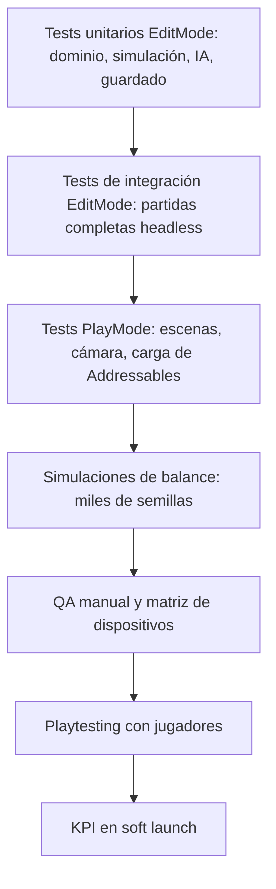

# 10 · QA, testing y balance

## 1. Estrategia general



La arquitectura por capas ([06_arquitectura_tecnica.md](06_arquitectura_tecnica.md)) permite que **la mayor parte de los tests sean EditMode**. Son rápidos (milisegundos), no abren escenas y se ejecutan en CI en cada pull request.

## 2. Unity Test Framework

### 2.1 Configuración

- Paquete `com.unity.test-framework` (incluido).
- `Assets/Tests/EditMode/GodGame.Tests.EditMode.asmdef`:
  - `references`: `GodGame.Domain`, `GodGame.Generation`, `GodGame.Simulation`, `GodGame.AI`, `GodGame.Save`
  - `optionalUnityReferences` / `overrideReferences`: `nunit.framework.dll`
  - `includePlatforms`: `["Editor"]`
  - `defineConstraints`: `["UNITY_INCLUDE_TESTS"]`
- `Assets/Tests/PlayMode/GodGame.Tests.PlayMode.asmdef`: lo mismo sin restringir a Editor, más `GodGame.Presentation`.
- Se ejecutan desde *Window → General → Test Runner* o en CI con `game-ci/unity-test-runner` (`testMode: all`).

### 2.2 Helper: reglas en memoria

```csharp
using GodGame.Domain;
using UnityEngine;

public static class TestRules
{
    public static UniverseRules Make(string id, float gravity = 1f, float time = 1f, int dims = 3)
    {
        var r = ScriptableObject.CreateInstance<UniverseRules>();
        r.id = id;
        r.gravityMultiplier = gravity;
        r.timeFlowRate = time;
        r.spatialDimensions = dims;
        r.modifiers = GameplayModifiers.Neutral;
        r.nativeSpeciesIds = new[] { "test_species" };
        r.galaxyCount = 1;
        r.systemsPerGalaxy = new Vector2Int(4, 6);
        r.planetsPerSystem = new Vector2Int(3, 6);
        return r;
    }

    public static UniverseRules[] Catalog7() => new[]
    {
        Make("ascendia", gravity: -1.2f), Make("cronalis", time: 2f), Make("teseracto", dims: 4),
        Make("resonancia"), Make("fulgor"), Make("thalassa"), Make("oniria")
    };
}
```

### 2.3 Tests de generación (determinismo y límites)

```csharp
using System.Linq;
using GodGame.Domain;
using GodGame.Generation;
using NUnit.Framework;

public class MultiverseGeneratorTests
{
    [Test]
    public void MismaSemilla_MismoMultiverso()
    {
        var catalog = TestRules.Catalog7();
        var a = MultiverseGenerator.Generate(1234, catalog);
        var b = MultiverseGenerator.Generate(1234, catalog);
        Assert.AreEqual(UnityEngine.JsonUtility.ToJson(a), UnityEngine.JsonUtility.ToJson(b));
    }

    [Test]
    public void NuncaMasDeSieteUniversos()
    {
        var catalog = TestRules.Catalog7().Concat(new[] { TestRules.Make("extra") }).ToArray();
        var mv = MultiverseGenerator.Generate(99, catalog, universeCount: 10);
        Assert.LessOrEqual(mv.universes.Count, Multiverse.MaxUniverses);
    }

    [Test]
    public void UniversoInicial_EsAleatorioYCubreTodos()
    {
        var catalog = TestRules.Catalog7();
        var starts = Enumerable.Range(0, 500)
            .Select(seed => MultiverseGenerator.Generate(seed, catalog).playerStartUniverseId.Split('-')[1])
            .GroupBy(id => id).ToDictionary(g => g.Key, g => g.Count());
        Assert.AreEqual(7, starts.Count, "Todos los universos deben poder ser el inicial");
        Assert.That(starts.Values.All(c => c > 500 / 7 * 0.5f), "Distribución razonablemente uniforme");
    }

    [Test]
    public void ElJugadorTienePlanetaAsignadoSinDueño()
    {
        var mv = MultiverseGenerator.Generate(7, TestRules.Catalog7());
        var player = mv.FindGod(MultiverseGenerator.PlayerGodId);
        var home = mv.AllPlanets().First(p => p.id == player.homePlanetId);
        Assert.IsTrue(home.civilization.Exists);
        Assert.IsFalse(home.HasOwner);
    }

    [Test]
    public void AñadirUnUniverso_NoCambiaLosExistentes()
    {
        var six = TestRules.Catalog7().Take(6).ToArray();
        var mv6 = MultiverseGenerator.Generate(42, six, universeCount: 6);
        var mv7 = MultiverseGenerator.Generate(42, TestRules.Catalog7(), universeCount: 7);
        foreach (var u in mv6.universes)
        {
            var same = mv7.universes.First(x => x.rulesId == u.rulesId);
            Assert.AreEqual(u.galaxies.Sum(g => g.systems.Count), same.galaxies.Sum(g => g.systems.Count));
        }
    }
}
```

> Nota: los ids de universo incluyen el índice (`U{index}-{rulesId}`), que sí depende del orden de barajado. El test compara por `rulesId`.

### 2.4 Tests de simulación

```csharp
using System.Linq;
using GodGame.Domain;
using GodGame.Generation;
using GodGame.Simulation;
using GodGame.Simulation.Commands;
using NUnit.Framework;

public class TurnManagerTests
{
    private GameState NewState(int seed = 5)
    {
        var catalog = TestRules.Catalog7();
        return new GameState(MultiverseGenerator.Generate(seed, catalog), catalog);
    }

    [Test]
    public void AlInicio_ElJugadorSoloAlcanzaSuPlanetaAsignado()
    {
        var s = NewState();
        var player = s.GetGod(MultiverseGenerator.PlayerGodId);
        var reachable = s.ReachableTargets(player).ToList();
        Assert.AreEqual(1, reachable.Count);
        Assert.AreEqual(player.homePlanetId, reachable[0].id);
    }

    [Test]
    public void ConquistaCultural_ConvierteEnVariosCiclos()
    {
        var s = NewState();
        var tm = new TurnManager(s);
        var player = s.GetGod(MultiverseGenerator.PlayerGodId);
        player.resources.faith = 10_000f; player.resources.divineEnergy = 10_000f;
        var home = s.GetPlanet(player.homePlanetId);
        home.civilization.faith = 0.9f; home.civilization.worshippedGodId = "ancestros";

        int turns = 0;
        while (home.ownerGodId != player.id && turns++ < 20)
        {
            Assert.IsTrue(tm.Submit(new ConquerPlanetCommand(player.id, home.id, ConquestType.Cultural), out var why), why);
            tm.ResolveTurn();
        }
        Assert.AreEqual(player.id, home.ownerGodId);
        Assert.Greater(turns, 1, "La conversión cultural no debe ser instantánea");
    }

    [Test]
    public void Resolucion_EsDeterminista()
    {
        string Run()
        {
            var s = NewState(77);
            var tm = new TurnManager(s);
            foreach (var g in s.Multiverse.gods.Where(g => !g.isPlayer))
                tm.RegisterSource(new GodGame.AI.GodUtilityAI(g.id));
            for (int i = 0; i < 50; i++) tm.ResolveTurn();
            return UnityEngine.JsonUtility.ToJson(s.Multiverse);
        }
        Assert.AreEqual(Run(), Run());
    }

    [Test]
    public void ComandoSinRecursos_EsRechazado()
    {
        var s = NewState();
        var tm = new TurnManager(s);
        var player = s.GetGod(MultiverseGenerator.PlayerGodId);
        player.resources = new ResourceWallet();
        Assert.IsFalse(tm.Submit(new ConquerPlanetCommand(player.id, player.homePlanetId, ConquestType.Militar), out var reason));
        Assert.AreEqual("resources.insufficient", reason);
    }
}
```

### 2.5 Tests de guardado

```csharp
using GodGame.Generation;
using GodGame.Save;
using NUnit.Framework;

public class SaveSystemTests
{
    [Test]
    public void IdaYVuelta_ConservaElEstado()
    {
        var catalog = TestRules.Catalog7();
        var state = new GodGame.Simulation.GameState(MultiverseGenerator.Generate(3, catalog), catalog, turn: 12);
        string json = SaveSystem.Serialize(SaveSystem.Capture(state));
        Assert.IsTrue(SaveSystem.TryDeserialize(json, out var data, out var err), err);
        Assert.AreEqual(12, data.turn);
        Assert.AreEqual(UnityEngine.JsonUtility.ToJson(state.Multiverse), UnityEngine.JsonUtility.ToJson(data.multiverse));
    }

    [Test]
    public void ArchivoManipulado_FallaElChecksum()
    {
        var catalog = TestRules.Catalog7();
        var state = new GodGame.Simulation.GameState(MultiverseGenerator.Generate(3, catalog), catalog);
        string json = SaveSystem.Serialize(SaveSystem.Capture(state)).Replace("\\\"turn\\\":0", "\\\"turn\\\":999");
        Assert.IsFalse(SaveSystem.TryDeserialize(json, out _, out var err));
        Assert.AreEqual("checksum_mismatch", err);
    }
}
```

Se guarda además un conjunto de **archivos de guardado de versiones antiguas** (`Tests/Fixtures/save_v1.json`...) y se comprueba que todos migran a la versión actual.

### 2.6 Tests PlayMode (ejemplos)

| Test | Comprueba |
|---|---|
| `Boot_CargaMenuEnMenosDe5s` | Arranque y Addressables |
| `ZoomPlanetaAGalaxia_SinExcepciones` | Cambios de capa de cámara |
| `PlanetaProcedural_GeneraMallaValida` | `ProceduralPlanet` crea una malla con el número de vértices esperado y bounds razonables |
| `CargarYLiberarUniverso_MemoriaVuelveABase` | `Addressables.Release` (con margen) |
| `PausaApp_GuardaAutosave` | Simula `OnApplicationPause(true)` |

## 3. Simulaciones automáticas de balance

Como la simulación es determinista y no depende de escenas, se puede **jugar miles de partidas IA contra IA** en batch mode.

### 3.1 Runner

```csharp
// Editor/BalanceRunner.cs: ejecutar con
// Unity -batchmode -projectPath . -executeMethod BalanceRunner.Run -quit -logFile balance.log
using System.IO;
using System.Linq;
using System.Text;
using GodGame.AI;
using GodGame.Domain;
using GodGame.Generation;
using GodGame.Simulation;
using UnityEditor;

public static class BalanceRunner
{
    public static void Run()
    {
        var catalog = AssetDatabase.FindAssets("t:UniverseRules")
            .Select(g => AssetDatabase.LoadAssetAtPath<UniverseRules>(AssetDatabase.GUIDToAssetPath(g)))
            .ToArray();

        var csv = new StringBuilder("seed,turns,winner,winnerUniverse,stagePlayerProxy\n");
        for (int seed = 0; seed < 2000; seed++)
        {
            var state = new GameState(MultiverseGenerator.Generate(seed, catalog), catalog);
            var tm = new TurnManager(state);
            // El "jugador" también lo controla una IA equilibrada (proxy de un humano medio).
            foreach (var g in state.Multiverse.gods)
            {
                if (g.isPlayer) g.isPlayer = false;
                tm.RegisterSource(new GodUtilityAI(g.id));
            }

            string winner = null;
            int turn = 0;
            for (; turn < 300 && winner == null; turn++) winner = tm.ResolveTurn().WinnerGodId;

            var proxy = state.GetGod(MultiverseGenerator.PlayerGodId);
            var w = winner != null ? state.GetGod(winner) : null;
            csv.AppendLine($"{seed},{turn},{winner ?? "none"},{w?.homeUniverseId ?? "-"},{state.ComputeStage(proxy)}");
        }
        File.WriteAllText("balance_results.csv", csv.ToString());
    }
}
```

### 3.2 Qué medir y umbrales

| Métrica | Umbral aceptable | Acción si falla |
|---|---|---|
| Tasa de victoria por **universo de origen** | Entre 10 % y 20 % cada uno (con 7, lo ideal es 14 %) | Ajustar los `modifiers` de ese universo |
| Tasa de victoria por **personalidad** | Ningún dios por encima del 25 % | Ajustar pesos y costes |
| Uso de cada **vía de conquista** por los ganadores | Cada vía entre el 20 % y el 50 % de las conquistas | Ajustar costes en `CommandCosts` |
| Ciclo medio de victoria | 150–300 (campaña), 40–80 (escaramuza) | Ajustar ingresos |
| Partidas sin ganador a los 300 ciclos | < 10 % | Revisar estancamientos (bloqueos de alcance) |
| Ciclo en que el proxy alcanza la escala Sistémica | 8–15 | Ajustar el onboarding y la economía inicial |
| Semillas "imposibles" (el proxy derrotado antes del ciclo 30) | < 1 % | Reforzar las garantías del generador |

Los resultados (CSV) se analizan con una hoja de cálculo o un notebook de Python/pandas. Se ejecuta **cada noche en CI** y se compara con la noche anterior.

### 3.3 Ajuste en vivo

Los multiplicadores clave de `UniverseRules.modifiers` y de `CommandCosts` se exponen en **Remote Config** (*BalanceConfig*). Si las simulaciones o la analítica real muestran desequilibrios, se corrigen sin publicar una nueva versión. Se hace con campañas A/B (por ejemplo, el 10 % de los jugadores con un coste cultural un 10 % menor) y se mide su efecto en la retención y en la tasa de finalización de capítulos.

## 4. Playtesting

| Tipo | Cuándo | Participantes | Método | Qué buscamos |
|---|---|---|---|---|
| Papel | Preproducción | 4–6 del equipo | Cartas y fichas | ¿El core loop tiene decisiones interesantes? |
| Gris digital | S4 | 5–8 conocidos | Observación + pensar en voz alta | Comprensión de los recursos y del ciclo |
| Vertical slice | S10 | 10–15 externos del público objetivo | Sesión de 30 min grabada + encuesta | Diversión, claridad del tutorial, "¿jugarías mañana?" |
| Alfa | Cada 2 sprints | 15–30 (Discord, TestFlight, Play internal) | Telemetría + encuesta | Ritmo, dificultad, bugs |
| Beta cerrada | S25–S30 | 200–1 000 | Analítica completa | Embudos, balance real, crashes |
| Soft launch | S29+ | Público de 2–3 países | KPI | Retención y monetización |

**Encuesta estándar** (escala de 1 a 5): diversión, claridad, ganas de volver, belleza visual, comprensión de la historia, frustración (inversa), más "¿qué cambiarías?" y "describe el juego en una frase".

**Señales de alarma:** abandonar en el tutorial (ver el embudo `tutorial_step`), más de 3 toques fallidos seguidos (zonas táctiles), preguntar "¿qué hago ahora?" más de 2 veces en 10 minutos.

## 5. KPI

| KPI | Definición | Objetivo soft launch | Benchmark de estrategia móvil |
|---|---|---|---|
| **Retención D1** | % de jugadores que vuelven al día siguiente | ≥ 40 % | 35–45 % |
| **Retención D7** | % que vuelven el día 7 | ≥ 15 % | 12–18 % |
| **Retención D30** | % que vuelven el día 30 | ≥ 6 % | 4–8 % |
| Duración de sesión | Mediana en minutos | 8–12 | — |
| Sesiones por DAU | Media diaria | ≥ 2,5 | — |
| Finalización del tutorial | % que llegan al ciclo 10 | ≥ 75 % | — |
| Finalización del Acto I | % de los instalados | ≥ 35 % | — |
| Crash-free sessions | Crashlytics | ≥ 99,5 % | — |
| ANR rate (Android) | Android Vitals | < 0,47 % | Umbral de Google |
| Conversión (F2P) | % de pagadores | ≥ 3 % | 2–5 % (premium-unlock) |
| ARPDAU | Ingreso por usuario activo y día | Referencia en el soft launch | — |
| Valoración media | Tiendas | ≥ 4,3 | — |

Los paneles se montan en UGS Analytics (o se exportan a BigQuery si se usa Firebase) con cohortes por **universo inicial**, para detectar si nacer en un universo concreto empeora la retención.

## 6. Matriz de dispositivos de prueba

| # | Dispositivo | SO | GPU | RAM | Rol |
|---|---|---|---|---|---|
| 1 | Samsung Galaxy A14 / A15 (o Redmi 12) | Android 13–14 | Mali-G52 / G57 | 4 GB | **Referencia de gama baja (30 fps)** |
| 2 | Motorola Moto G (gama de entrada) | Android 12–14 | Adreno 610 | 3–4 GB | Adreno de gama baja |
| 3 | Samsung Galaxy A54 / A55 | Android 14 | Mali-G68 | 6–8 GB | **Referencia de gama media (60 fps)** |
| 4 | Google Pixel 7a / 8a | Android 14–15 | Mali-G710 | 8 GB | Android de referencia limpio |
| 5 | Samsung Galaxy S23 / S24 | Android 14–15 | Adreno 740 / Xclipse | 8 GB | Gama alta |
| 6 | iPhone XR o 11 | iOS 17–18 | A12 / A13 | 3–4 GB | **Referencia iOS mínima** |
| 7 | iPhone 13 / 14 | iOS 18 | A15 | 4–6 GB | iOS medio |
| 8 | iPad (9.ª gen) o iPad Air | iPadOS 17–18 | A13 / M1 | 3–8 GB | Tableta: UI y relación de aspecto |

Se complementa con **granjas en la nube** (Firebase Test Lab, AWS Device Farm o BrowserStack App Live) para cubrir más modelos en la beta, con *Robo tests* y pruebas de instalación y arranque.

## 7. QA manual: checklist por versión

- [ ] Instalación limpia y actualización desde la versión anterior (con guardado migrado).
- [ ] Partida nueva con 5 semillas distintas, una de ellas compartida por la comunidad.
- [ ] Las 3 vías de conquista, los 4 milagros y la diplomacia básica.
- [ ] Zoom por todas las escalas sin tirones (> 25 fps en gama baja durante la transición).
- [ ] Interrupciones: llamada entrante, notificaciones, bloquear la pantalla a mitad de la resolución, quedarse sin batería (con el modo avión forzando el cierre) → el autosave es correcto.
- [ ] Sin conexión: el juego completo funciona. Al recuperar la conexión, Cloud Save sincroniza.
- [ ] Compras: compra, cancelación, restauración, reembolso (Play) y *Ask to Buy* (iOS).
- [ ] Localización: ES y EN completos, textos largos sin cortes y pseudolocalización.
- [ ] Accesibilidad: modo daltónico, tamaño de texto al 140 % y modo sin destellos.
- [ ] Rendimiento: benchmark automático sin regresiones y prueba de térmica de 15 min.

## 8. Gestión de bugs

| Severidad | Definición | Tiempo de respuesta |
|---|---|---|
| S1 · Bloqueante | Crash, pérdida de guardado, compra no entregada | Hotfix en menos de 48 h |
| S2 · Mayor | Una función clave no funciona y no hay alternativa | Siguiente versión |
| S3 · Menor | Hay alternativa o es un problema visual | Planificado |
| S4 · Cosmético | Erratas, alineación | Cuando haya tiempo |

Cada bug incluye **semilla + ciclo + guardado adjunto**. Gracias al determinismo, casi todos los bugs de simulación se pueden reproducir exactamente en el editor.
