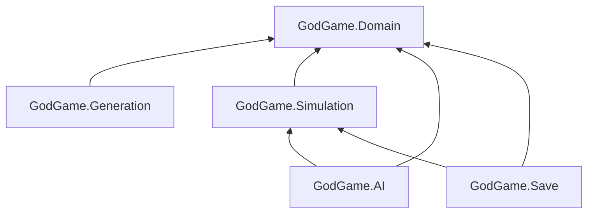

# Código de ejemplo (Unity 6 LTS, C#, URP)

Este código es la **base del prototipo gris** (sprints S2–S4 del [plan](../07_plan_de_trabajo_y_cronograma.md)). Implementa el modelo de datos, la generación procedural del multiverso, el sistema de turnos simultáneos con comandos, la IA de dioses rivales, el guardado y los shaders clave. No incluye escenas, UI ni arte: esa es la capa de Presentación descrita en [06_arquitectura_tecnica.md](../06_arquitectura_tecnica.md).

> El código está escrito para compilar en Unity 6 con los paquetes indicados, pero no se ha compilado dentro de un proyecto Unity real. Al importarlo, revisa la consola por si tu versión de Unity o de los paquetes cambia alguna API.

## 1. Requisitos

| Paquete | Id | Para qué |
|---|---|---|
| Universal RP | `com.unity.render-pipelines.universal` | Shaders (`Packages/com.unity.render-pipelines.universal/ShaderLibrary/...`) |
| Burst | `com.unity.burst` | `PlanetMeshGenerator` |
| Mathematics | `com.unity.mathematics` | `float3`, `noise.snoise` |
| Collections | `com.unity.collections` | `NativeArray` |
| Test Framework | `com.unity.test-framework` | Tests de [10_QA_testing_y_balance.md](../10_QA_testing_y_balance.md) |

Para crear el proyecto: *Unity Hub → New project → Unity 6 LTS → plantilla "Universal 3D"*. Burst, Mathematics y Collections se instalan desde *Window → Package Manager → Unity Registry* si no vienen ya.

## 2. Dónde colocar cada archivo

Copia la carpeta `codigo/` a `Assets/_Game/Code/` y los shaders a `Assets/_Game/Shaders/`:

| Archivo | Destino en el proyecto | Assembly | Qué hace |
|---|---|---|---|
| `Domain/UniverseRules.cs` | `Assets/_Game/Code/Domain/` | `GodGame.Domain` | ScriptableObject con las leyes físicas (`gravityMultiplier`, `timeFlowRate`, `spatialDimensions`, `lightSpeedFactor`, `energyType`...) y `GameplayModifiers` |
| `Domain/MultiverseModel.cs` | idem | `GodGame.Domain` | Modelo serializable: `Multiverse`, `Universe`, `Galaxy`, `StarSystem`, `Star`, `Planet`, `Civilization`, `God`, `ResourceWallet` |
| `Domain/RandomExtensions.cs` | idem | `GodGame.Domain` | Utilidades de `System.Random` y `DeriveSeed` (hash FNV-1a estable) |
| `Generation/MultiverseGenerator.cs` | `Assets/_Game/Code/Generation/` | `GodGame.Generation` | Genera hasta 7 universos por semilla y asigna al azar el universo y el planeta iniciales del jugador; crea los 7 dioses rivales |
| `Generation/GalaxyGenerator.cs` | idem | `GodGame.Generation` | Espiral logarítmica (sistemas jugables + puntos de polvo) |
| `Generation/StarSystemGenerator.cs` | idem | `GodGame.Generation` | Estrellas por tipo espectral OBAFGKM, planetas, órbitas keplerianas y `EvaluateOrbitPosition`; también `NameGenerator` |
| `Generation/PlanetMeshGenerator.cs` | idem | `GodGame.Generation` | Esfera cubo-normalizada + fBm simplex en un job **Burst** paralelo |
| `Generation/ProceduralPlanet.cs` | idem | `GodGame.Generation` | Componente para ver o editar un planeta en la escena |
| `Simulation/GameState.cs` | `Assets/_Game/Code/Simulation/` | `GodGame.Simulation` | Estado + índices + `ProgressionStage` + alcance (`CanReach`) + azar por turno |
| `Simulation/TurnManager.cs` | idem | `GodGame.Simulation` | Turnos simultáneos: recoger, ordenar, validar, ejecutar, economía, progresión y victoria; `TurnReport` y `TurnEvent` |
| `Simulation/Commands/ICommand.cs` | `.../Simulation/Commands/` | `GodGame.Simulation` | `ICommand` e `ICommandSource` |
| `Simulation/Commands/CommandCosts.cs` | idem | `GodGame.Simulation` | Costes centralizados y `MiracleType` |
| `Simulation/Commands/ConquerPlanetCommand.cs` | idem | `GodGame.Simulation` | Conquista militar, cultural y tecnológica |
| `Simulation/Commands/MiracleCommand.cs` | idem | `GodGame.Simulation` | Bendición, Profeta, Revelación y Cataclismo |
| `AI/GodUtilityAI.cs` | `Assets/_Game/Code/AI/` | `GodGame.AI` | Utility AI con personalidad (implementa `ICommandSource`) |
| `Save/SaveSystem.cs` | `Assets/_Game/Code/Save/` | `GodGame.Save` | JSON versionado + checksum + escritura atómica + `.bak` + migraciones |
| `Shaders/PlanetSurface.shader` | `Assets/_Game/Shaders/` | — | Biomas por gradiente, toon en bandas, polos, océano, luces nocturnas |
| `Shaders/PlanetAtmosphere.shader` | idem | — | Halo de atmósfera por Fresnel con terminador |
| `Shaders/ToonCharacter.shader` | idem | — | Toon de personajes: rampa, sombras, rim, especular, emisión, contorno |
| `*/GodGame.*.asmdef` | Junto a cada carpeta | — | Definen los assemblies y sus dependencias |

**Dependencias entre assemblies** (sin ciclos):



## 3. Cómo probarlo

### 3.1 Ver un planeta procedural (2 minutos)

1. *Create → 3D Object → Create Empty*, llamado "Planet". Añade el componente **ProceduralPlanet** (se añaden `MeshFilter` y `MeshRenderer` automáticamente).
2. Crea un material con el shader **GodGame/PlanetSurface**. En `_BiomeRamp` asigna una textura de 256×1 (puedes pintar un degradado azul → arena → verde → gris → blanco en Krita), con *Wrap Mode* en Clamp.
3. Ajusta `terrainSeed`, `resolution` (64) y `shape` (`seaLevel` 0,45, `elevationScale` 0,06). El planeta se regenera en el editor porque el componente usa `[ExecuteAlways]`.
4. **Atmósfera:** añade como hijo una *Sphere* de Unity con escala de 2,1 (la esfera por defecto mide 1 de diámetro y el planeta tiene radio 1, así que 2,1 la deja un 5 % mayor), con un material **GodGame/PlanetAtmosphere**. Quita su `SphereCollider`.
5. Coloca una *Directional Light* (la "estrella") y gírala para ver el terminador y el halo.

### 3.2 Generar un multiverso y jugar turnos (script de prueba)

1. Crea los assets de reglas con *Assets → Create → GodGame → Universe Rules*. Haz al menos 2 (p. ej. `thalassa`, `resonancia`) con los valores de [03 §2](../03_universos_y_leyes_fisicas.md) y rellena `nativeSpeciesIds` con algún id (p. ej. `mareantes`).
2. Crea un MonoBehaviour en `Assets/_Game/Code/App/` (su asmdef debe referenciar Domain, Generation, Simulation, AI y Save):

```csharp
using System.Linq;
using GodGame.AI;
using GodGame.Domain;
using GodGame.Generation;
using GodGame.Save;
using GodGame.Simulation;
using GodGame.Simulation.Commands;
using UnityEngine;

public class GodGameSandbox : MonoBehaviour
{
    [SerializeField] private UniverseRules[] catalog;
    [SerializeField] private int seed = 2026;
    [SerializeField] private int turnsToSimulate = 20;

    private void Start()
    {
        Multiverse mv = MultiverseGenerator.Generate(seed, catalog, "El Octavo");
        var state = new GameState(mv, catalog);
        var turns = new TurnManager(state);

        foreach (var god in mv.gods.Where(g => !g.isPlayer))
            turns.RegisterSource(new GodUtilityAI(god.id));

        var player = state.GetGod(mv.playerGodId);
        Debug.Log($"Semilla {seed}: naces en {mv.playerStartUniverseId}, planeta asignado {player.homePlanetId}");

        turns.TurnResolved += report =>
        {
            foreach (var e in report.Events.Where(e => e.godId == player.id || e.type == TurnEventType.Victory))
                Debug.Log($"[Ciclo {report.Turn}] {e.type} {e.planetId} -> {e.messageKey}");
        };

        for (int i = 0; i < turnsToSimulate; i++)
        {
            // El "jugador" intenta convertir su planeta asignado por la vía cultural.
            var cmd = new ConquerPlanetCommand(player.id, player.homePlanetId, ConquestType.Cultural);
            if (!turns.Submit(cmd, out string reason)) Debug.Log($"Orden rechazada: {reason}");
            turns.ResolveTurn();
        }

        SaveSystem.Save(0, SaveSystem.Capture(state));
        Debug.Log($"Guardado en {Application.persistentDataPath}/saves/slot_0.json. Escala: {state.ComputeStage(player)}");
    }
}
```

3. Pon el componente en un GameObject vacío, arrastra los assets `UniverseRules` al array `catalog` y pulsa **Play**. En la consola verás el universo asignado al azar, los ciclos de conversión y la ruta del guardado. Cambia `seed` para ver otros inicios.

### 3.3 Tests automáticos

Copia los tests de [10_QA_testing_y_balance.md](../10_QA_testing_y_balance.md) §2 a `Assets/Tests/EditMode/` con su asmdef y ejecútalos en *Window → General → Test Runner → EditMode → Run All*. Comprueban el determinismo, el límite de 7 universos, la distribución aleatoria del universo inicial, el alcance inicial, la conversión cultural en varios ciclos y la ida y vuelta del guardado.

### 3.4 Shader toon

Crea un material **GodGame/ToonCharacter** y asígnalo a cualquier modelo (por ejemplo, un personaje de Mixamo). Ajusta `_RampThreshold`, `_RampSmooth`, `_RimColor` y `_OutlineWidth`. Para que proyecte y reciba sombras, el URP Asset debe tener las sombras de la luz principal activadas.

## 4. Notas de diseño del código

- **Dominio y simulación sin MonoBehaviour.** Se pueden testear en EditMode y simular miles de partidas en batch mode.
- **Ids en lugar de referencias** en el modelo, para serializar sin ciclos.
- **Determinismo:** todo azar sale de `System.Random` con sub-semillas (`DeriveSeed`). La iteración usa listas en orden de generación, nunca el orden de un `Dictionary`.
- **Burst:** `CubeSphereJob` solo usa tipos *blittable* (`float3`, `NativeArray`, `struct`). Para depurar sin Burst, desactiva *Jobs → Burst → Enable Compilation*. El código se ejecuta igual, solo que más lento.
- **SRP Batcher:** los 3 shaders declaran sus propiedades en `CBUFFER_START(UnityPerMaterial)`. El Inspector del shader debe decir "SRP Batcher: compatible".
- **Extensiones previstas, no incluidas:** regiones del planeta (Acto I), diplomacia, reglas especiales por universo (`IUniverseRule`, ver [03 §4.4](../03_universos_y_leyes_fisicas.md)), presentación (vistas, cámara, UI) y servicios (UGS, IAP).
